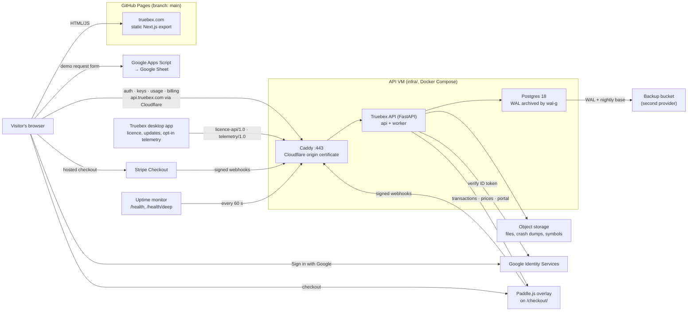

# Truebex

Website, account portal and developer API for **Truebex — True Building
Experience**, live at **https://truebex.com**.

Truebex itself is a desktop building design platform: measured daylight,
self-arranging surfaces, assets that update everywhere. This repo is everything
around it on the web:

- **Marketing site:** a static Next.js export on GitHub Pages.
- **Dashboard:** sign in with Google or email, manage API keys, see usage, and handle billing.
- **API server** (`server/`, FastAPI): accounts, API keys, usage metering, billing through the UK company (Paddle as reseller by default, Stripe with Stripe Tax as the alternative), licences, devices and the release feed for the desktop app, its opt-in telemetry, crash reports and feedback, and cloud projects (an operation log in server order, snapshots, versions, sharing and presence), served at `api.truebex.com` from a Linux VM (Docker Compose behind Cloudflare, built from [`infra/`](infra/README.md)).
- **Demo-request form:** writes to a Google Sheet via Apps Script.

> **Two repos, one GitHub project.** This folder (`X:\Truebex`, branch
> `master`) is the **source**. The live site is the **build output**, which lives
> in a separate clone (`X:\Truebex_site_files\Truebex`, branch `main`). GitHub
> Pages serves `main`. Read [Deployment](#deployment) before you change anything.

---

## Contents

- [Architecture](#architecture)
- [Repository layout](#repository-layout)
- [Branches](#branches)
- [Local development](#local-development)
- [Environment variables](#environment-variables)
- [Deployment](#deployment)
- [API server](#api-server-server)
- [Google sign-in](#google-sign-in)
- [API keys and usage](#api-keys-and-usage)
- [Licences, releases and downloads](#licences-releases-and-downloads)
- [Organisations, seats and SSO](#organisations-seats-and-sso)
- [Cloud projects](#cloud-projects)
- [Share links](#share-links)
- [Marketplace (PF7)](#marketplace-pf7)
- [Supplier portal (PF8)](#supplier-portal-pf8)
- [Billing: Paddle and Stripe](#billing-paddle-and-stripe)
- [Brand, content and SEO](#brand-content-and-seo)
- [Demo request form](#demo-request-form)
- [Known issues](#known-issues)

---

## Architecture



The site is fully static, so `NEXT_PUBLIC_*` URLs are **baked in at build
time**. Anything that switches on later (the Google client ID and the payment
providers) is read from the API at runtime through `/config` and
`/billing/plans`. Turning those on needs only `server/.env` and a server
restart, not a rebuild.

---

## Repository layout

```
src/
  app/
    page.tsx               Landing page (+ SoftwareApplication & FAQPage JSON-LD)
    layout.tsx             Global metadata, fonts, Organization JSON-LD, verification tags
    pricing/               Plans from server/app/catalogue.json (+ comparison, FAQ)
    features/[slug]/       One page per search cluster (FEATURE_PAGES)
    roadmap/ changelog/    Roadmap (src/content/roadmap.json); changelog (milestones + releases, version anchors) + feed.xml
    ar/                    Arabic landing page (RTL; lang/dir set by scripts/postbuild-lang.mjs)
    login/ signup/         Auth pages (Google + email)
    dashboard/             Signed-in area: overview (download, licence, devices), projects/ (+ view/?id=),
                           shares/, billing/, link/ (approve a sign-in from the app), keys/ + usage/ (Developer),
                           admin/growth/ + admin/telemetry/
    invite/project/        Accept a project invitation (?t=, noindex)
    download/              Public Download page (from src/content/releases.json)
    developers/            Public API docs (indexable)
    supplier/              Supplier portal (noindex): signup/, join/, catalogue/, prices/, imports/,
                           inbox/, analytics/, billing/, team/
    account/               Redirect to /dashboard/ (old URL)
    sitemap.ts robots.ts manifest.ts icon.svg apple-icon.png favicon.ico
  components/
    brand/Logo.tsx         Lockup / LogoMark / Wordmark from the Figma masters
    sections/              Landing sections (Hero, CoreFeatures, Pricing, FAQ, …)
    dashboard/             Shell (auth guard, nav), UsageChart, UsageMeter
    supplier/              SupplierShell (auth guard, supplier switcher, nav by role), SignupForm, JoinPanel
    releases/              DownloadPanel, ReleaseNotes
    auth/                  AuthForm, GoogleButton, ProfileMenu
  lib/
    constants.ts           ALL site copy: features, pricing, feature pages, Arabic, FAQ, SITE
    catalogue.ts           Plan catalogue types, price formatting, JSON-LD offers
    api.ts                 fetch wrapper, session token, date helpers
    auth.ts                accounts + Google sign-in
    developer.ts           keys, usage, billing calls
    licence.ts             licence API calls (devices, link approval, release feed)
    projects.ts            project service calls (projects, people, versions, presence, invitations)
    supplier.ts            supplier portal calls (X-Truebex-Supplier header), template download
    plans.ts               plan names and limits from server/app/catalogue.json
    releaseNotes.ts        the release-notes Markdown subset, parsed to a React-rendered tree
    shares.ts              share links (list, visits, extend, end)
    telemetryAdmin.ts      admin telemetry dashboard calls
  viewer/                  the share page's viewer (no framework) → out/viewer/viewer.js + .css
  content/                 roadmap.json, history.json; releases.json + releases-beta.json (the release
                           feed as of the last `npm run sync:releases`)
public/
  brand/                   SVG media kit (mark + wordmark, grey/white/dark)
  images/product/          In-app captures (generated)
  images/og-image.jpg      1200×630 social card (generated)
scripts/make_web_assets.py Regenerates brand assets from the Unreal project
scripts/sync-releases.mjs  `npm run sync:releases`: release feed → src/content/releases.json (+ releases-beta.json)
scripts/postbuild-lang.mjs <html lang="ar" dir="rtl"> for out/ar/ (part of npm run build)
scripts/build-viewer.mjs   runs after `next build`: src/viewer → out/viewer (+ PDF.js)
scripts/sync-roadmap.mjs   Roadmap statuses from the two trackers (owner, before a deploy)
scripts/indexnow.mjs       Ping IndexNow with changed URLs (owner, after a deploy)
scripts/serve-out.py       serves out/ with CORS like GitHub Pages (autopilot-serve.ps1)
server/
  app/
    main.py                App + routers
    routers/               auth, keys, usage, billing, v1 (developer API), licence, releases, admin, files,
                           growth, telemetry, admin_telemetry, projects, uploads, shares (+ /view/{slug}, /robots.txt)
    billing/               service.py (plan state) · base.py (BillingProvider) · paddle_, stripe_, wayl_provider.py · jobs.py
    licence/               devices, link codes, seats, signed entitlements (Ed25519 over RFC 8785 JSON)
    releases/              signed release manifests, feed, download links
    telemetry/             contracts/telemetry.md: service, privacy scanner, symbolication, jobs
    projects/              contracts/project-log.md: the log and its §6.3 rule, snapshots, versions, members,
                           presence, quotas, the on_ops_accepted push hook, jobs
    uploads/               share-bundle §5: resumable, content-addressed uploads (8 MiB hashed parts; PF5's, used by PF4)
    shares/                share records, manifest rules, derivatives, preview card, the page's HTML
    idempotency.py         Idempotency-Key for contract POSTs (24 h)
    storage/ mail/         blob storage (local, s3) · mail (console, smtp) with templates
    tasks.py worker.py     periodic jobs (@periodic), inline or in the worker process
    ratelimit.py contract_http.py health.py ops.py   shared plumbing (PF14): limits, contract header and
                           error envelope, /health/deep, backup checks and alerts
    models.py database.py  SQLAlchemy models + additive migrations (SQLite and Postgres)
    catalogue.json         Tiers, entitlement matrix, prices per interval and currency, founding offer (read by the site at build time)
    plans.py               Reads catalogue.json: prices, entitlement matrix, request quotas, key limits
    growth/                Admin growth counts (sign-ups, downloads, trials, checkouts)
  scripts/                 sync_prices.py (catalogue prices → Paddle or Stripe) · make_signing_key.py · publish_release.py ·
                           make_licence_fixtures.py · sqlite_to_postgres.py · upload_symbols.py · make_admin.py ·
                           make_share_fixtures.py · demo_share.py · demo_replica.py (a scripted project replica) ·
                           make_project_log_fixtures.py
  tests/                   pytest suite (+ mock_paddle.py, mock_wayl.py for click-through tests; contracts/licence/,
                           contracts/telemetry/, contracts/share-bundle/ and contracts/project-log/ = contract fixtures)
  Dockerfile               the API image (api and worker services)
infra/                     the API host: OpenTofu, cloud-init, Compose, Caddy, backups,
                           monitoring, deploy.ps1, restore-test.ps1, CUTOVER.md
.claude/skills/            truebex-brand-voice · truebex-seo · truebex-deploy
google-apps-script/        Code.gs for the demo-request sheet
deploy-to-server.bat       Build → copy into the deploy repo → commit → push
start-server.bat           Local use only: API on 127.0.0.1:8001 (production is the VM)
start-tunnel.bat           Local use only: cloudflared (no longer serves api.truebex.com)
```

---

## Branches

| Branch | Local clone | Contains | Notes |
|---|---|---|---|
| `master` | `X:\Truebex` | **Source code** | Commit your work here. |
| `main` | `X:\Truebex_site_files\Truebex` | **Built site** + `.github/` | Default branch. Every push deploys to GitHub Pages. Never edit by hand. |
| `gh-pages` | — | An old build (May 2026) | **Stale, not served.** Safe to delete. |

---

## Local development

**Requirements:** Node.js 20+ and Python 3.12. Use 3.12 specifically, because the
pinned server dependencies don't install on 3.14.

```bash
npm install
cp .env.example .env.local          # fill in the values (see below)

# API (separate terminal): creates server/.venv on first run, serves :8000
server\run.bat
```

> **Don't use `npm run dev` on this machine.** Turbopack's dev server spawned
> hundreds of PostCSS workers and used up all RAM. Test with a production build
> instead:
>
> ```bash
> NEXT_PUBLIC_AUTH_URL=http://127.0.0.1:8000 npm run build
> cd out && py -3.12 -m http.server 3001
> ```
>
> Then run the API with `CORS_ORIGINS=http://localhost:3001`. Rebuild with
> production URLs before deploying.

Server tests: `server\.venv\Scripts\python.exe -m pytest -q` (run from `server/`).

---

## Environment variables

### Frontend: `.env.local` (template: [`.env.example`](.env.example))

| Variable | Purpose | Production value |
|---|---|---|
| `NEXT_PUBLIC_AUTH_URL` | API base URL | `https://api.truebex.com` |
| `NEXT_PUBLIC_SHEETS_URL` | Apps Script web app URL for the demo form | `https://script.google.com/macros/s/…/exec` |

These end up in the public JavaScript, so never put secrets in them.

### API: `server/.env` (template: [`server/.env.example`](server/.env.example))

| Variable | Purpose |
|---|---|
| `SECRET_KEY` | Signs session JWTs. Long random string. |
| `ACCESS_TOKEN_EXPIRE_MINUTES` | Session lifetime (default 1440 = 24 h) |
| `DATABASE_URL` | SQLite locally (default `sqlite:///./auth.db`); `postgresql+psycopg://…` on the VM |
| `CORS_ORIGINS` | Must include `https://truebex.com,https://www.truebex.com` |
| `SITE_URL`, `API_URL` | Public URLs used in checkout redirects and webhook URLs |
| `GOOGLE_CLIENT_ID` | OAuth Web client ID. Empty hides the Google button. |
| `BILLING_PROVIDER` | `paddle` (default) or `stripe`: the provider checkout uses |
| `PADDLE_ENV`, `PADDLE_API_KEY`, `PADDLE_WEBHOOK_SECRET`, `PADDLE_CLIENT_TOKEN` | `sandbox`/`production`; key and webhook secret enable Paddle; the client token (public) is served by `/config` for Paddle.js |
| `PADDLE_API_BASE` | Optional override of Paddle's API host (the local mock) |
| `STRIPE_SECRET_KEY`, `STRIPE_WEBHOOK_SECRET` | Both enable Stripe |
| `STRIPE_PRICE_PRO` | The original monthly Pro price: existing subscribers keep Pro |
| `STRIPE_TAX_ENABLED` | `true` turns on Stripe Tax (`automatic_tax`) |
| `WAYL_ENABLED`, `WAYL_API_KEY`, `WAYL_WEBHOOK_SECRET`, `WAYL_ENV`, `WAYL_PRICE_PRO_IQD` | Dormant rail: off unless `WAYL_ENABLED=true`; never offered on the site |
| `SUBSCRIPTION_NOTICES_ENABLED`, `SUBSCRIPTION_RULES_FROM`, `EU_WITHDRAWAL_ENABLED`, `LEGAL_WORDING_APPROVED`, `CONSENT_VARIANT` (+ lead times, `COMPANY_ADDRESS`, `EULA_URL`) | Subscription consumer rules (PF2b), all off until the solicitor signs off; see [Billing](#billing-paddle-and-stripe) |
| `LICENCE_SIGNING_KEY`, `LICENCE_KEY_ID` | The `lic-*` Ed25519 seed that signs entitlements (`scripts/make_signing_key.py --kind lic`). Empty = licensing off (503). |
| `RELEASE_PUBLIC_KEYS` | Public `rel-*` keys as `kid:key,…` (the seeds never live on the API host) |
| `SIGNING_KEYS_EXTRA`, `TRIAL_DAYS` | Old `lic-*` public keys during a rotation; trial length (14) |
| `STORAGE_BACKEND`, `STORAGE_DIR`, `STORAGE_URL_SECRET` | `local` files under `./storage`, served by signed `/files` URLs on `API_URL`, or `s3` |
| `S3_*`, `CDN_BASE_URL` | The S3-compatible bucket (`STORAGE_BACKEND=s3`) and the CDN for its public prefixes |
| `MAIL_BACKEND`, `MAIL_FROM`, `SUPPORT_EMAIL`, `SMTP_*` | Mail: `console` locally, `smtp` on the VM |
| `BACKGROUND_TASKS` | `inline` (default), `worker` (the VM's worker process) or `off` (tests): telemetry rollup and retention, symbolication, link purge, 90-day device lapse, founding holds, billing reconcile, backup checks, floating-seat lease and invite expiry, SSO request and audit purges |
| `RATELIMIT_BACKEND` | `memory` (one process) or `db` (the VM's two API processes) |
| `ALERT_EMAIL`, `ALERT_PUSH_URL`, `BACKUP_EXPECTED` | Alerts from the server's own backup check |
| `TELEMETRY_EVENTS_ENABLED`, `TELEMETRY_INGESTION_ENABLED` | The usage-events kill switch; telemetry as a whole (off → 503) |
| `SSO_SECRET_KEY` | Fernet key sealing organisations' SSO client secrets (empty derives one from `SECRET_KEY`) |
| `SAML_SP_ENTITY_ID`, `AUDIT_RETENTION_DAYS` | This service's SAML entity id (empty: each organisation's metadata URL); how long the audit log keeps events (730) |
| `FEED_PULL_HOUR_UTC` | Hour (UTC) the registered supplier feed URLs are read each day (2) |
| `MARKET_MEDIA_FIXTURES` | Local trials only: serve the contract feed's picture and 3D URLs from `tests/contracts/marketplace` |
| `PROJECTS_PRESENCE_BACKEND` | Project presence: `memory` (one process) or `db` (the VM's two API processes) |
| `PROJECTS_MAX_WAITING_PULLS` | Long-poll pulls one account may hold open at once, per API process (20) |
| `SHARE_MAX_BYTES` | Ceiling on one share upload's total bytes (the upload protocol; 1 GiB) |

On the VM these come from `infra/secrets/*.sops.env` (template: `infra/secrets/server.env.example`).

---

## Deployment

```
master (X:\Truebex) ──npm run build──▶ out/ ──copy──▶ main (X:\Truebex_site_files\Truebex) ──push──▶ GitHub Pages
```

1. Commit and push `master`.
2. Make sure `.env.local` holds the **production** URLs.
3. Run **`deploy-to-server.bat`**. It builds, backs up the deploy folder,
   replaces everything except `.git`/`.github` with `out/`, commits, and pushes `main`.
4. Watch the "Deploy static content to Pages" run under the repo's **Actions** tab.

The full checklist, including how to verify the live site, is in
[`.claude/skills/truebex-deploy/SKILL.md`](.claude/skills/truebex-deploy/SKILL.md).

**Gotchas**

- **Git "dubious ownership" in the deploy folder.** Run `git config --global --add safe.directory X:/Truebex_site_files/Truebex` once. This is already done on this PC.
- **Custom domain.** Set in the repo's *Settings → Pages* (`main` has no `CNAME`).
- **Paths.** `next.config.ts` relies on `trailingSlash: true` and `assetPrefix: "/"` for nested routes on Pages.

---

## API server (`server/`)

FastAPI + SQLAlchemy on Postgres in production and SQLite locally; every model
and query runs on both (`database.dialect_insert` is the one place a dialect is
named). Passwords use bcrypt, and sessions are JWTs kept in `localStorage`. New
columns are added on startup by `database._ADDED_COLUMNS`; these migrations are
additive only. Interactive API docs are served at `https://api.truebex.com/docs`.
Contract endpoints (`/telemetry/*`) answer errors in the shared envelope
`{detail, code, status, request_id, retry_after_s, data}`.

| Method | Path | Auth | Purpose |
|---|---|---|---|
| GET | `/health` | — | Liveness → `{"status":"ok"}` |
| GET | `/health/deep` | — (rate-limited) | Database, storage round trip, worker heartbeat → 200 or 503 |
| GET | `/config` | — | Public feature flags (Google client ID) |
| POST | `/auth/register` · `/auth/login` | — | Email/password → session token |
| POST | `/auth/google` | — | Google ID token → session token (signs up, signs in, or links) |
| GET | `/auth/me` | session | Current user |
| GET / POST / DELETE | `/keys`, `/keys/{id}` | session | List, create (key shown once), revoke |
| GET | `/usage` | session | This month: total, limit, daily, by endpoint, by key |
| GET | `/billing/plans` | — | Tiers, prices per interval and currency, founding offer, checkout provider |
| GET | `/billing/subscription` · `/billing/payments` | session | Tier, interval, seats, renewal; payment history |
| POST | `/billing/checkout` | session | `{tier, interval, currency, seats, coupon?, consent}` → checkout URL |
| POST | `/billing/payments/{ref}/refresh` | session | Re-check a payment with its provider |
| POST | `/billing/seats` · `/billing/change` | session | Seats, or tier / interval, prorated |
| GET | `/billing/invoices` | session | Invoices with PDF links |
| POST | `/billing/portal` | session | The provider's customer portal |
| POST | `/billing/cancel` · `/billing/withdraw` | session | Cancel in Billing (`{confirm: true, refund?}`) · EU withdrawal (`{confirm: true}`); the plan changes on the provider's webhook |
| GET | `/billing/payments/{ref}` | session | One checkout with the key information the buyer acknowledged |
| POST | `/billing/webhooks/paddle` · `/stripe` · `/wayl` | provider | Payment events (`/wayl` only with `WAYL_ENABLED`) |
| GET | `/v1/ping` · `/v1/account` | **API key** | Developer API (metered) |
| POST | `/licence/link` · `/licence/link/poll` | — / poll secret | The app starts a browser sign-in and polls for its session |
| POST | `/licence/link/approve` · GET `/licence/link/{code}` | session | The website shows the device and approves or denies |
| POST | `/licence/activate` | session | Register a device → device token + signed entitlement |
| POST | `/licence/entitlement` · `/licence/trial` · `/licence/deactivate` | **device** | Fresh entitlement · the 14-day Pro trial · sign out |
| GET | `/licence/account` | **device** | The app's Account panel |
| GET / DELETE | `/licence/devices`, `/licence/devices/{id}` | session or device | List and remove devices |
| GET | `/licence/keys` | — | Published public keys (`lic-*`, `rel-*`) |
| GET | `/releases/feed` · `/releases/{version}/download` | — | Signed release manifests · a 15-minute download link |
| GET / POST / PATCH | `/admin/releases`, `/admin/releases/{version}` | admin | Upload (≤ 90 MB, signed off-host), withdraw, new notes |
| GET | `/admin/growth?from=&to=` | session, admin | Sign-ups, downloads, trials, checkouts, paid per UTC day (counts only) |
| GET | `/telemetry/config` | — | Event allow-list, sampling, kill switch (`X-Truebex-Contract: telemetry/1.0`) |
| POST | `/telemetry/events` · `/crashes` · `/feedback` · `/delete` | — (device token for a feedback reply; install secret for delete) | Opt-in usage events, crash reports, feedback, deletion |
| GET / PATCH / POST | `/admin/telemetry/*` · `/admin/feedback/*` · `/admin/symbols` | **admin** | Telemetry dashboard, crash groups, feedback inbox and replies, symbols |
| POST / GET | `/projects`, `/projects/{id}` (+ PATCH, DELETE) | session or device (DELETE: session) | Cloud projects: create, list owned and shared, open, rename, delete |
| POST / GET | `/projects/{id}/ops` | editor / viewer | Push operations (§6.3 order and conflicts) · pull after a number (long-poll ≤ 25 s) |
| POST / GET | `/projects/{id}/snapshots`, `…/snapshots/latest` | editor / viewer | Register an uploaded `.tbxp` (+ `.tbxpack`) · the newest with 15-minute URLs |
| GET / POST | `/projects/{id}/versions`, `…/versions/{vid}/restore` | viewer / editor | Named versions · restore (appends a `restore` operation) |
| GET / POST / PATCH / DELETE | `/projects/{id}/members[/{user_id or invite_id}]` | viewer / owner (or the member leaving) | People and invitations by email |
| PUT / GET | `/projects/{id}/presence` | viewer | Heartbeat (30 s) · who is here |
| POST | `/projects/invites/accept` | session | Accept an emailed invitation (`/invite/project/?t=`) |
| POST / PUT / GET | `/uploads`, `/uploads/{id}/files/{sha256}/parts/{n}`, `/uploads/{id}` | session or device | Resumable uploads in 8 MiB parts (`share-bundle/1.0`) |
| GET / PUT | `/files/{key}?exp=&sig=` | signed URL | Local storage downloads and uploads (HMAC, expiring) |
| POST | `/licence/release` | **device** | Hand a floating seat back at exit (contract 5.11) |
| POST / GET | `/orgs` | session | Create an organisation (you become owner) · your organisations |
| GET / PATCH / DELETE | `/orgs/{id}` | member / admin / owner | Details · rename · delete (409 with a live subscription) |
| GET · PATCH / DELETE | `/orgs/{id}/members` · `/orgs/{id}/members/{user_id}` | member · admin (or self) | Members · change role, remove, leave (409 `last_owner`) |
| POST / GET / DELETE | `/orgs/{id}/invites`, `…/{invite_id}`, `…/{invite_id}/resend` | admin | Invite by e-mail (7-day link), list, revoke, resend |
| POST | `/invites/preview` · `/invites/accept` | — · session | What `/invite/` shows · accept with the invited address |
| GET · PUT | `/orgs/{id}/seats` · `/seats/settings` · `/seats/{user_id}` | admin | Seats and leases · how many float · give a named / floating seat |
| GET | `/orgs/{id}/usage?month=` · `/orgs/{id}/audit?kind=&cursor=&format=csv` | admin | Usage per member · the audit log (JSON or CSV) |
| GET / PUT / DELETE | `/orgs/{id}/sso` · POST `/orgs/{id}/sso/break-glass` | owner | OIDC or SAML connection (secrets write-only) · a new break-glass code |
| POST / GET / DELETE | `/orgs/{id}/domains`, `…/{domain}/verify` | owner | E-mail domains, verified by a DNS TXT record |
| GET | `/auth/sso/start?email=&next=` | — | 302 to the organisation's identity provider (`format=json` → `{url}`) |
| GET · POST | `/auth/sso/oidc/callback` · `/auth/sso/saml/{slug}/acs` | `state` · signed assertion | Finish SSO → `/login/sso/#token=…` |
| GET | `/auth/sso/saml/{slug}/metadata` | — | SP metadata XML |
| POST · PUT · GET | `/uploads`, `/uploads/{id}/files/{sha256}/parts/{n}`, `/uploads/{id}` | device, session, worker | Resumable upload: open, send a part, what arrived |
| POST | `/shares` · `/shares/{id}/publish` | **device** | Create a share from a bundle manifest · publish once every file arrived |
| GET / PATCH / DELETE | `/shares`, `/shares/{id}` | session or device | List with visits · change title or expiry · end the link |
| GET · POST | `/s/{slug}` · `/s/{slug}/visits` | — | The viewer's data (URLs signed for 1 h) · count a visit |
| GET | `/view/{slug}` · `/s/{slug}/card.jpg` | — | The share page (its own link preview) · its 1200 × 630 card |

### Running in production

The API runs on **one Linux VM** with Docker Compose: Caddy (443, Cloudflare
origin certificate, only Cloudflare's ranges allowed in), two uvicorn processes,
a worker for background jobs, and Postgres 18 whose WAL is archived continuously
(nightly base backups, 30 days, at a second provider; a weekly restore test).
Everything is rebuilt from [`infra/`](infra/README.md); the one-time move off the
home PC is [`infra/CUTOVER.md`](infra/CUTOVER.md) (RPO 5 minutes, RTO 2 hours).

- **Deploy:** `powershell -NoProfile -ExecutionPolicy Bypass -File infra\deploy.ps1 -VmHost truebex@<vm>`
  (committed HEAD, secrets decrypted with sops only for the copy, waits for `/health/deep`).
- **Health:** `https://api.truebex.com/health` (liveness) and `/health/deep`
  (`{"db":"ok","storage":"ok","worker_heartbeat_s":…}`, 503 when anything is down).
- **Alerts:** a hosted monitor checks both every 60 s from several regions and
  alerts by e-mail and phone push; the host checks disk, memory, load,
  containers, the 5xx rate and the certificate every minute; the worker alerts
  on stale backups. Details: [`infra/README.md`](infra/README.md#alerts).
- **Backups:** `infra\restore-test.ps1 -VmHost truebex@<vm>` → `restore OK`.
- **Admins:** `cd server; .venv\Scripts\python.exe -m scripts.make_admin <email>`
  (on the VM: `docker compose exec api python -m scripts.make_admin <email>`).

`start-server.bat` and `start-tunnel.bat` are for local use only. An API left
running on the PC with its own `auth.db` would accept writes nobody sees, so the
tunnel no longer routes `api.truebex.com`. While the site cannot reach the API
(Cloudflare 52x), the dashboard shows a "can't reach the server" message rather
than logging people out.

---

## Google sign-in

- **Frontend:** `GoogleButton.tsx` loads Google Identity Services and asks the
  API's `/config` for the client ID. It renders nothing when none is set.
- **Backend:** `POST /auth/google` verifies the ID token's signature, audience,
  issuer and expiry with `google-auth`, and requires a verified email. Then:
  - a known Google account signs in;
  - an existing email/password account gets Google linked to it;
  - otherwise a password-less account is created.

**Configured (2026-10-07).** Google Cloud project `truebex`, Google Auth
Platform app "Truebex" (External, **In production**, basic scopes only, no
logo, so no verification is needed). Its Web client "Truebex Website" allows the
JavaScript origins `https://truebex.com`, `https://www.truebex.com`,
`http://localhost:3001` and `http://localhost:3000`. The client ID is in
`server/.env` as `GOOGLE_CLIENT_ID`. The consent screen links to
[`/privacy/`](https://truebex.com/privacy/) and [`/terms/`](https://truebex.com/terms/),
so keep those pages live. Adding a logo to the consent screen would trigger
Google's verification review.

---

## API keys and usage

- Keys look like `tbx_live_…`. Only a SHA-256 hash is stored, and the full key is shown once at creation.
- Clients send the key as `Authorization: Bearer <key>` or `X-API-Key: <key>`.
- Every `/v1` call is counted per key, per endpoint, per UTC day (`usage_daily`).
- The monthly quota per plan is in `server/app/catalogue.json` (read by `plans.py`; the site imports the same file). Over quota returns `429`.
- Responses carry `X-RateLimit-Limit` and `X-RateLimit-Remaining`.

| Plan | Requests / month | Active keys |
|---|---|---|
| Free (`free`) | 1,000 | 2 |
| Pro (`pro`) | 100,000 | 20 |
| Studio, Team (`studio`, `team`) | 100,000 (placeholder until GD7) | 20 |
| Enterprise | 5,000,000 (set by hand) | 200 |

Public docs: [`/developers/`](https://truebex.com/developers/).

---

## Licences, releases and downloads

The desktop app's licence API follows the contract `licence-api` v1.0.0, which
lives in the Unreal project (`Docs/roadmap/40/contracts/licence-api.md`; the app
side is authoritative). Every licence route echoes `X-Truebex-Contract:
licence-api/1.0` and answers errors as `{detail, code, status, request_id,
retry_after_s, data}`.

- **Sign-in.** The app asks for a link code (`/licence/link`), opens
  `/dashboard/link/?code=…`, and polls until the signed-in person presses
  Approve. Email + password sign-in from the app uses `/auth/login` unchanged.
- **Devices.** `/licence/activate` returns a `tbx_dev_…` device token (stored as
  SHA-256) and a signed entitlement. Two devices per seat for now; the same
  computer keeps its device. Tokens lapse after 90 days unused.
- **Entitlements.** Ed25519 over the RFC 8785 bytes of the document, kid
  `lic-*`; refresh after 24 h, honoured offline for 14 days (floating seats:
  30 min / 2 h). The plan comes from `licence/seats.py` `seat_source(user)`;
  features and limits from `catalogue.json` (the contract's placeholder matrix
  until GD7).
- **Trial.** One 14-day Pro trial per account and per computer, stored as a
  `subscriptions` row with `provider="trial"`.
- **Releases.** Publish on the host:

  ```powershell
  cd server
  .venv\Scripts\python.exe scripts\make_signing_key.py --kind rel --out D:\keys\rel-2026-10.json   # once; keep it off the API host
  .venv\Scripts\python.exe scripts\publish_release.py --version 1.1.0 --channel stable --platform win64 `
      --file D:\builds\Truebex-Setup-1.1.0.exe --notes notes.md --key-file D:\keys\rel-2026-10.json `
      --symbols D:\builds\1.1.0\Symbols   # the build's .pdb / .sym files, for crash symbolication
  cd ..; npm run sync:releases   # then build and deploy the site
  ```

  The feed (`/releases/feed`) serves the manifests exactly as signed; downloads
  get a 15-minute signed URL and need no account. Check any envelope or
  manifest with `python -m app.licence.signing verify <file> [--keys <url>]`.

## Organisations, seats and SSO

A practice buys seats once and runs them itself at `/dashboard/organisation/`
(the Workspace switcher above the dashboard navigation picks Personal or an
organisation). Roles: owner, admin, billing, member; at least one owner always.

- **Seats.** The organisation's tier and seat count come from a
  `subscriptions` row with `organisation_id` set (PF2 sets it from checkout;
  until then, and for Enterprise, by hand). Of those seats, the Seats tab
  decides how many float; the rest are named. `seat_source(user)` picks the
  best of the person's own plan and their organisation seats by tier rank;
  an organisation's tier never reaches `users.plan`.
- **Floating seats.** A floating member's device takes a lease with its
  entitlement (`refresh_after` 30 min, `expires_at` 2 h) and renews it at each
  refresh; `POST /licence/release` hands it back at exit; a lease not renewed
  lapses after 2 h (`licence.leases.expire`). A full pool answers 409
  `no_seat_available`. Leases are taken under the organisation row's lock, so
  two devices never get the last seat.
- **Audit log.** Organisation events plus the members' licence events, kept 24
  months (`AUDIT_RETENTION_DAYS`), exportable as CSV.
- **SSO (Enterprise).** OIDC (code + PKCE) or SAML 2.0 (signed assertions,
  checked with `signxml`), one connection per organisation; only verified
  domains (DNS TXT `_truebex-verification.<domain>`) route sign-in, and people
  join as members just in time. "Require SSO" refuses password and Google
  sign-in for those domains; owners keep a one-time break-glass code. The
  session returns to `/login/sso/` in the URL fragment.
- **Hand tools** (in `server/`):

  ```powershell
  .venv\Scripts\python.exe scripts\grant_org_seats.py --org studio-north --tier team --seats 2 [--until 2027-10-31]
  .venv\Scripts\python.exe scripts\verify_org_domain.py --org studio-north --domain example.com   # local tests only
  .venv\Scripts\python.exe scripts\try_device.py --email b@example.com --password … --name "Test PC 2" --refresh   # act as the app
  .venv\Scripts\python.exe -m uvicorn tests.mock_oidc:app --port 8098       # mock OIDC provider (tests)
  .venv\Scripts\python.exe -m uvicorn tests.mock_saml_idp:app --port 8099   # mock SAML IdP (tests)
  ```

  With `MAIL_BACKEND=console` (the default) invitation e-mails print in the API
  console.

---

## Cloud projects

The project service follows the contract `project-log` v1.0.0 (Unreal project,
`Docs/roadmap/40/contracts/project-log.md`; the app side is authoritative).
Every route echoes `X-Truebex-Contract: project-log/1.0`; errors use the shared
envelope.

- **The log.** A project is an append-only log of operations; the server gives
  each accepted one the next `server_seq` under a lock on the project row
  (contiguous under concurrent pushes), answers a repeated `op_id` with its
  first number, and rejects an operation when another replica changed one of its
  `touched` ids after its `base_seq` (`rejected` with the `winning` operations;
  the rest of the batch `not_processed`). It never decodes a delta or runs an
  action. Deltas over 64 KiB live in storage (`projects/{id}/ops/`).
- **Pulls** long-poll up to 25 s on the event loop, woken by the next push (a
  push on the other API process is seen within 1 s).
- **Snapshots** upload through `/uploads` (purpose `snapshot`), are copied to
  `projects/{id}/blobs/{sha256}` and kept: the newest five plus every named
  version's (`projects.snapshots.prune`, hourly). Restore appends a `restore`
  operation that every replica applies.
- **People.** Owner, editor, viewer (the contract's §4 matrix); non-members get
  404. Invitations are emailed links with a 256-bit token (stored hashed) that
  attach to whoever accepts while signed in. Only a session deletes a project
  (soft delete; rows and files go after 30 days, `projects.purge_deleted`).
- **Plans.** Creating, inviting and pushing from the app need `cloud.sync`;
  quotas `cloud_projects`, `cloud_bytes`, `project_members` are placeholders in
  `server/app/projects/quotas.py` until GD7 (a value in `catalogue.json`
  `limits` wins).
- **Without the app:** `server/scripts/demo_replica.py` signs a "computer" in,
  pushes the contract fixtures, pulls, makes a conflicting move and holds
  presence, exactly as the app will (`--help`).

---

## Share links

The app's Share command (contract `share-bundle` v1.0.0, in the Unreal project's
`Docs/roadmap/40/contracts/`) uploads a bundle (panoramas with hotspots,
renders, the sheet PDF) through `/uploads` in 8 MiB parts and publishes it with
`/shares`. Publishing makes 4096- and 1024-wide copies of every panorama and a
1200 × 630 preview card. The link is `${SHARE_BASE_URL}/view/{slug}` (empty
`SHARE_BASE_URL` = `API_URL`): the API writes that share's own title, card and
`noindex` around the viewer, which the page loads from
`${SITE_URL}/viewer/viewer.js` (built by `npm run build`). truebex.com must keep
answering `Access-Control-Allow-Origin: *` (GitHub Pages does).

- Visits count once a day per visitor id the page keeps for 24 h; no address or
  user agent is stored. A link ends at its expiry or when ended from the
  dashboard (410 "This link has ended"); its files go 7 days later.
- Limits per plan: live links `limits.share_links`; longest expiry and bytes
  per bundle from `SHARE_MAX_DAYS` / `SHARE_MAX_BYTES` until the plan matrix
  carries `share_days` / `share_bytes`.
- Try it without the app: `cd server; .venv\Scripts\python.exe scripts\demo_share.py
  --email <you> --password <pw> --fixture tests\contracts\share-bundle\manifest-house.json`
  (needs `LICENCE_SIGNING_KEY`, like any device sign-in).

---

## Marketplace (PF7)

The catalogue behind the app's marketplace follows the contract `marketplace-api` v1.1.0 (the Unreal
project's `Docs/roadmap/40/contracts/marketplace-api.md`); routes echo `X-Truebex-Contract:
marketplace-api/1.1` and answer errors in the shared envelope. Code: `server/app/market/`,
`server/app/routers/market.py` and `market_admin.py`; pages `/market/checkout/`, `/dashboard/orders/`,
`/dashboard/admin/market/`.

- **Catalogue (5.1–5.6).** Categories rooted on the app's taxonomy (`market/taxonomy/categories.json`,
  a byte copy of the app's file; 5.1 reports its SHA-256), regions GB and AE (`market/regions.json`),
  search through SQLite FTS5, prices as integer minor units per region. Anonymous reads are limited
  per address (`MARKET_READS_PER_MINUTE`).
- **Orders and requests (5.7–5.10).** Every line is priced again on the server; an order is split per
  supplier and paid on `/market/checkout/` (Stripe Checkout, transfers to each supplier's Stripe
  Connect account after it accepts, minus the commission). `MARKET_PAYMENTS_ENABLED` stays `false`
  until the marketplace terms are signed off, so every supplier takes requests for quote only.
- **Feeds.** `market/importer.py` turns CSV / JSON feeds (contract §6.4) into products, prices and
  availability with a row-level report; PF8 adds the supplier endpoints and portal. Admins can import a
  file for a supplier from `POST /admin/market/feeds`.
- **Picture search.** `POST /market/search/image` (≤ 5 MB) with `EMBEDDING_MODEL=clip-vit-b32` after
  `scripts\fetch_models.py` (weights stay out of git).
- **A local trial catalogue:**

  ```powershell
  cd server
  .venv\Scripts\python.exe -m pip install -r requirements.txt   # Pillow, numpy, onnxruntime, tokenizers
  .venv\Scripts\python.exe scripts\seed_market.py --fixture tests\contracts\marketplace [--payments-ready]
  .venv\Scripts\python.exe scripts\market_try.py --email you@example.com --password ... --kind quote   # or order
  ```

  The fixtures in `server/tests/contracts/marketplace/` are made by `scripts\make_market_fixtures.py`
  (`--check` compares them with this server's answers).

---

## Supplier portal (PF8)

Companies that sell furniture, finishes and fittings run their Truebex catalogue at `/supplier/`
(noindex, every page usable at 375 px). Code: `server/app/supplier/`, `server/app/routers/supplier.py`,
`src/app/supplier/`, `src/components/supplier/`, `src/lib/supplier.ts`; e-mails in `server/app/mail/`.

- **Sign-up and verification.** `/supplier/signup/`: company, regions and contact, one company PDF
  (≤ 10 MB, admins read it from Admin → Market → Suppliers → Application). The supplier is `applied` until
  an admin verifies it; until then it prepares products but cannot submit them.
- **Roles.** `owner` (everything), `catalogue` (products, prices, imports), `orders` (the inbox),
  `viewer` (reads). Invitations by e-mail (`/supplier/join/?token=…`, 7 days).
- **Catalogue, prices, imports.** Products with variants, pictures and checked 3D files (format by its
  bytes, ≤ 100 MB, ≤ 500 000 triangles, size against `dims_mm`); a price and stock grid per region
  that refuses what a feed would (`bad_price`, `currency_mismatch`, …); uploads of the XLSX template
  (`GET /supplier/imports/template.xlsx`), CSV or JSON with a dry run kept 24 h, then Apply.
- **Feeds for supplier systems (contract 5.11–5.13).** `POST /market/feeds` (202 queued),
  `PUT /market/feeds/source` (an https URL read daily at 02:00 UTC), `GET /market/feeds/{id}` (the
  report), with a supplier key from Team → Supplier keys (`Authorization: Bearer tbx_live_…`). Supplier
  keys work only there; developer keys stay under Dashboard → API keys.
- **Inbox, analytics, billing.** Requests for quote answered with prices and a message; orders accepted,
  shipped (carrier, reference) and delivered. Daily counts per product and region (impressions, views,
  placements, requests, orders, order value; no buyer identities). Listing plans, monthly statements,
  and the Stripe Connect payout link.
- **Jobs.** `market.feeds.run` (30 s), `market.feeds.pull` (daily, 02:00 UTC), `supplier.imports.purge`
  (24 h), `supplier.listing.sync` (10 min).
- **A local trial** (the API on :8000 with `MAIL_BACKEND=console` and
  `MARKET_MEDIA_FIXTURES=tests/contracts/marketplace` in `server/.env`; the site built with
  `NEXT_PUBLIC_AUTH_URL=http://127.0.0.1:8000`): apply at `/supplier/signup/`, verify it as an admin,
  then upload `server/tests/contracts/marketplace/feed-two-regions.csv` under Imports.

---

## Billing: Paddle and Stripe

Truebex Ltd (the UK company) sells every plan. **Paddle** is the default: it
is the reseller and Merchant of Record, so it charges VAT or sales tax for the
buyer's country, files it, issues the invoice and handles chargebacks.
**Stripe** stays behind the same interface with Stripe Tax for business
invoices (Enterprise, marketplace fees) and as a one-setting switch
(`BILLING_PROVIDER=stripe`). Each provider turns on when its keys are in
`server/.env`; the site says "being set up" until `/billing/plans` names a
`provider`.

**The rule:** a plan, a seat count or a founding price changes only from a
provider event or provider state the server verified itself (signed webhooks,
API fetches). The browser names a tier, an interval, a currency and seats; the
server picks the price.

**Catalogue.** `server/app/catalogue.json` holds the tiers (Free, Pro, Studio,
Team per seat, Enterprise), their prices in GBP, USD and EUR and the founding
offer: the owner's pricing plan (PF2a). Pro and Studio are monthly or annual;
Team is annual only (from 2 seats), so a monthly Team checkout answers 400 and
the site shows Team per month as the annual charge / 12, billed annually; the
founding prices are the annual prices at `founding.discount_percent` off
(`founding.intervals`). The public pages show prices only while
`prices_final` is true. The site imports the file at build time
(`src/lib/catalogue.ts`); the API serves it at `/billing/plans`.
`server/scripts/sync_prices.py` mirrors every price, and each founding price,
to the provider and records the ids in `provider_prices`. Run it after any
price change (`--dry-run` lists what it would create):

```
cd server
.venv\Scripts\python.exe scripts\sync_prices.py --provider paddle --env sandbox
```

**Checkout.** The billing page asks for the cancellation consent (versioned in
`src/lib/constants.ts` `BILLING.consent` and `server/app/billing/consent.py`;
stored on the payment), then `POST /billing/checkout`. Paddle: the server opens
a transaction with `custom_data` naming the user and returns
`/checkout/?_ptxn=…`, where Paddle.js shows the overlay. Stripe: hosted
Checkout with `automatic_tax`, tax-ID and address collection, and its own
consent box. Coupons (`?code=` on billing links) are the provider's own codes.

**Founding seats.** An annual checkout of a founding tier holds a founding
place for 30 minutes; a paid one keeps it for good and the subscription keeps
the founding price while it stays on annual billing (a move to monthly ends
it). The count left is on `/billing/plans`, `/pricing/` and the billing page.

**Webhooks and jobs.** Paddle: `https://api.truebex.com/billing/webhooks/paddle`
(subscription.* and transaction.* events; HMAC over `ts:body`, 300 s window).
Stripe: `/billing/webhooks/stripe` (`checkout.session.completed`/`expired`,
`customer.subscription.*`). Both are de-duplicated by event id
(`billing_events`) and an older event never overwrites newer state. Jobs in
`server/app/billing/jobs.py`: `billing.founding.expire` (5 min) and
`billing.reconcile` (daily, and at start: re-fetches pending checkouts and live
subscriptions, covering webhooks missed while the PC was off). The billing page
also re-checks a payment when the buyer returns.

To set up Paddle (sandbox first):
1. Create the account at sandbox-vendors.paddle.com; set a default payment link
   and approve the checkout domain (`truebex.com`; localhost works in sandbox).
2. Developer tools → Authentication: an API key and a client-side token.
3. Notifications: a destination at `<API_URL>/billing/webhooks/paddle` for
   `subscription.*` and `transaction.*`; copy its secret key.
4. `server/.env`: `BILLING_PROVIDER=paddle`, `PADDLE_ENV=sandbox`,
   `PADDLE_API_KEY`, `PADDLE_WEBHOOK_SECRET`, `PADDLE_CLIENT_TOKEN`; then run
   `sync_prices.py --provider paddle --env sandbox` and restart the API.
5. Production needs Paddle's seller and domain approval, which checks the live
   pricing, terms, refund and privacy pages.

To set up Stripe: keys in `STRIPE_SECRET_KEY`, `STRIPE_WEBHOOK_SECRET`; a
terms-of-service URL in the Stripe dashboard (Checkout's consent box needs it);
Stripe Tax registrations if `STRIPE_TAX_ENABLED=true`; then
`sync_prices.py --provider stripe --env sandbox`.

`server/tests/mock_paddle.py` stands in for Paddle's API for a click-through
without an account (see its docstring): run it on :8098, set
`PADDLE_API_BASE=http://127.0.0.1:8098` and
`PADDLE_WEBHOOK_SECRET=pdl_ntfset_mock_secret`, sync prices, and checkout opens
the mock's pay page instead of Paddle.js.

**Subscription consumer rules (PF2b), switched off.** Built to GD5 §7 and off
until the solicitor approves the wording (details and the switch table:
[`docs/roadmap/40/PF2b-subscription-consumer-rules.md`](docs/roadmap/40/PF2b-subscription-consumer-rules.md)):
- **Always on:** **Cancel subscription** in Billing (cancel at the period
  end, confirmation e-mail, no portal needed).
- `SUBSCRIPTION_NOTICES_ENABLED` from `SUBSCRIPTION_RULES_FROM`: renewal
  reminders and trial-end notices (job `billing.subscription_notices`), and
  **Cancel and get a refund** within 14 days of an annual renewal.
- `EU_WITHDRAWAL_ENABLED`: **Withdraw from contract** for EU consumers.
- `LEGAL_WORDING_APPROVED`, together with a site build with
  `NEXT_PUBLIC_LEGAL_WORDING_APPROVED=true`: the key information and GD5's
  consent box at checkout (`CONSENT_VARIANT`), and the order confirmation
  e-mail.

The wording lives in `server/app/billing/notices.py` and `BILLING` in
`src/lib/constants.ts`. Cancellations, refunds and withdrawals only ask the
provider; the plan changes when its signed webhook arrives, and failed provider
calls are retried by `billing.exits.retry`. To read console mails locally, run
the API with `--log-config scripts/log-info.json`. Stripe needs `invoice.paid`
on its webhook endpoint for renewals.

**Wayl (dormant).** The Iraqi payment rail is retired from the site and the
catalogue. Its code stays behind `WAYL_ENABLED=false` and its tests run with
the flag on; setting `WAYL_ENABLED=true` with its keys brings back
`/billing/webhooks/wayl` and an IQD price on `/billing/plans` (API only).

---

## Brand, content and SEO

- **Brand source of truth:** the Unreal project.
  - Logo masters: `T:\unreal5_7_4_projects\truebex_compact\Brand\Truebex\logo\figma_original`.
  - Colors: `MwBrand.cpp` (`#232323` / `#CBCBCB`) and `MwTheme.cpp` (accent `#A0CEFF`).
  - Font: Segoe UI, with an Open Sans fallback on the web, since Segoe UI isn't licensed for web hosting.
- **Regenerating assets:** `py -3.12 scripts/make_web_assets.py` rebuilds the
  icons, OG card, SVG media kit and product captures.
- **Site copy:** all of it lives in `src/lib/constants.ts`. Only shipped features go in
  `FEATURES`; planned ones go in `src/content/roadmap.json` (words by hand,
  statuses from `npm run sync:roadmap -- <app README> <platform README>`).
  Public copy never names the engine or other software, and leads with
  distinctive features only (see `truebex-brand-voice`).
- **Prices:** `server/app/catalogue.json` is the one source; a tier without a
  price shows "Price at launch". Try the pricing page with sample prices by
  building with `TRUEBEX_CATALOGUE_FILE=scripts/fixtures/catalogue-sample.json`
  (never for a release).
- **Analytics and search engines:** `ANALYTICS.cloudflareToken` (Cloudflare Web
  Analytics, cookieless, public pages only), `VERIFICATION` (Search Console and
  Bing tags) and `SOCIAL` in `constants.ts`; empty values switch each off. The
  IndexNow key is `public/<32 hex>.txt`; run `npm run indexnow -- --sitemap`
  after a deploy.
- **Product image:** the site shows a single clean capture (daylight through
  a doorway). Add more only if they have no HUD or labels.
- **Project skills** (Claude Code picks these up automatically in this repo):
  - `truebex-brand-voice`: voice, claims rules, visual tokens.
  - `truebex-seo`: per-page checklist, keyword map, indexing and distribution playbook.
  - `truebex-deploy`: ship and verify.

---

## Demo request form

The "Request a Demo" form posts to a Google Apps Script web app that appends to
a Google Sheet. See [`google-apps-script/README.md`](google-apps-script/README.md).

---

## Known issues

| Issue | Impact | Where |
|---|---|---|
| One API VM is a single point of failure | RPO 5 minutes, RTO 2 hours (rebuilt from `infra/`) | `infra/CUTOVER.md` |
| Provider names are placeholders | VM, buckets, mail relay and uptime monitor wait for GD3 | `infra/README.md` |
| Payment providers need merchant keys | Billing shows "being set up" until keys are added | `server/.env` |
| Desktop app doesn't read the plan yet | The licence API is live, but the app's sign-in and gates (LC1, LC3) are not shipped | Unreal project |
| Cloud projects wait for the app | The project service is live, but the app's cloud save (CL1) and collaboration (CL2) are not shipped; `demo_replica.py` stands in | Unreal project |
| Installers are served from this PC | Downloads go through the home tunnel until PF14 adds object storage and a CDN | `server/storage/` |
| Share bundles are stored on this PC too | Uploads (up to 1 GiB a share) fill the host disk until PF14's object storage | `server/storage/blobs/`, `shares/` |
| `npm run dev` exhausts RAM on this PC | Use build + static server for local checks | — |
| The demo form can't detect failures (`no-cors`) | It always shows "Request received!" | `CTAContact.tsx` |
| Stale `gh-pages` branch | Confusing; not served | — |

---

## Organisation billing (PF3a)

Organisations buy and change seats through the same billing as people. The
organisation console's **Billing** link opens `/dashboard/billing/?org=<id>`:
an owner or a billing member buys there (Team preselected), changes seats,
plan or interval, opens the provider's portal and downloads the
organisation's invoices; admins and members see the plan read-only.

- **API.** `POST /billing/checkout`, `GET /billing/subscription`,
  `POST /billing/seats`, `POST /billing/change`, `POST /billing/portal`,
  `GET /billing/invoices` and `GET /billing/payments` take an optional
  `org_id` (32 hex): 403 for admin and member, 404 outside the organisation.
  One subscription per organisation (409 `live_subscription`); a person's own
  subscription and their organisations' never block each other.
- **Attaching.** The checkout's payment row records `organisation_id`, and
  Paddle `custom_data` / Stripe metadata carry `org_id`, but a subscription
  becomes the organisation's only from our payment row, matched by the
  provider's own link (Paddle: the subscription's originating transaction;
  Stripe: our Checkout Session). `custom_data` alone never attaches one
  (`server/app/billing/org_billing.py`).
- **Seats.** `service.seats_assigned` = named seats assigned + the floating
  pool; fewer seats than that answers 409 `seats_assigned`. Members get the
  organisation's tier through their named or floating seat; the buyer's own
  plan never changes. `/licence/account` reports `seats {total, assigned}`.
- **Locally**, with `tests/mock_paddle.py` as in the billing section: buy
  Team for an organisation from its billing page, pay on the mock's page, and
  you return to `/dashboard/billing/?org=<id>`.

---

## Cloud rendering

The render queue follows the contract `render-jobs` v1.1.0 (Unreal project,
`Docs/roadmap/40/contracts/render-jobs.md`; the app side is authoritative).
Every route echoes `X-Truebex-Contract: render-jobs/1.1`; errors use the shared
envelope. The code is `server/app/render/`, the routes `server/app/routers/jobs.py`
(5.1–5.6), `workers.py` (5.7–5.10), `tiles.py` and `admin_render.py`.

- **Jobs.** The app (a device token), the website (a session) or the developer
  API (an API key, metered like `/v1`) submits a `panorama` set, a `tiles` update
  or a `pack` against a project and a sequence number, with an `Idempotency-Key`.
  The answer carries an estimate in cost units; 5.2 long-polls the job's `rev`
  (25 s). Kinds `wind` and `energy` arrive with PF11 on the same queue.
- **The queue is the `render_jobs` table.** A worker claims with its token
  (`tbx_wrk_…`, issued and revoked in Admin → Render, stored hashed, scoped to
  kinds): one conditional UPDATE (`FOR UPDATE SKIP LOCKED` on Postgres), a
  120 s lease kept alive by heartbeats every 30 s, cancel delivered through the
  heartbeat, three retries (the fourth lapse fails the job), 24 h in the queue
  expires it. A job only goes to a worker whose `doc_version_max` reads its log.
- **Followed sets.** A `follow: true` panorama subscribes to the project's
  pushes (PF4's push hook): each push queues one `tiles` job with the pushed
  `touched` ids, or joins the set's queued one, so a burst of edits is one render.
  Each finished update replaces the set's manifest and bumps its `rev`.
- **Tiles** are content-addressed JPEGs at `tiles/<sha256>.jpg`, immutable and
  readable from any origin, served from `TILES_BASE_URL` (the CDN in front of
  the data bucket in production, `infra/README.md`; this API's `/tiles/` route
  locally). Manifests stay private (5.5). `render.tiles.gc` drops tiles no
  manifest of the last 90 days names.
- **Cost units.** 1 cu = 1 minute on `gpu-std`; charged on success only, rounded
  up to 0.1 cu, into `meter_daily` (`server/app/metering.py`). The allowance is
  `limits.cloud_cu_month`; until GD7 writes it, the placeholders in
  `server/app/render/quotas.py` apply (Pro 120, Studio and Team 600, Enterprise
  unlimited). Studio and Team may set an overage cap on `/dashboard/cloud/`; the
  overage is charged monthly through the billing provider (`render.overage.charge`).
- **Pages.** `/dashboard/cloud/` (usage, recent jobs, cancel, a live cube-tile
  preview of a followed set), `/dashboard/admin/render/` (queue, pool, workers,
  tokens, cost). `src/viewer/cube.ts` and `live.ts` are the share viewer's
  cube-tile mode: a share panorama with `live_job_id` (a followed set of the
  share's account) shows the set's tiles and swaps them as edits re-render,
  through `GET /s/{slug}/live`; ending the share ends it.
- **Workers.** `worker/truebex_worker.py` (Python 3.12, standard library only)
  claims, downloads the inputs, writes the job file, runs
  `Truebex.exe -mwrender=<job.json>`, uploads the tiles and completes; settings
  in `worker.toml` (`worker/worker.toml.example`). `infra/worker/bootstrap.ps1`
  sets up a Windows GPU machine; `build-image.ps1` makes the golden image.
- **Without the app's headless render:** run the worker with
  `--app worker\tests\fake_truebex.py` (it writes the contract fixtures' tiles),
  and submit with `server\scripts\demo_render.py --token tbx_dev_… submit
  --project <id> --follow`; `demo_replica.py … move --project <id>` makes an edit;
  `demo_share.py --token tbx_dev_… --fixture tests\contracts\share-bundle\manifest-house.json
  --live <follow job id>` shares the house with the living room live.

Known gaps: the app's headless render (CL3) and its Cloud panorama command
(CL4) are not shipped, so cloud panoramas stay on the roadmap in the public
copy; `live_job_id` and `/s/{slug}/live` are a share-bundle MINOR proposal until
the owner writes them into the contract.

## Analysis and AI services

Two contracts (Unreal project, `Docs/roadmap/40/contracts/`; the app side is authoritative): `render-jobs` v1.0.0
for the analysis kinds and `ai-proxy` v1.0.0 for the metered assistant proxy. The code is `server/app/analysis/`
and `server/app/ai/`, the routes `server/app/routers/analysis_ai.py` (one router for the feature).

- **Analysis jobs** use PF6's queue (`POST /jobs`, `/workers/*`): `wind` (CFD), `energy` (building energy
  simulation, `params.weather` from the weather library) and `acoustics` (room acoustics by ray tracing) need the
  `analysis.reports` feature, run on `cpu-8` workers and upload their inputs as `job-input` files. The answer
  carries an estimate from GD3's worked examples (cells × iterations, zones × timesteps, rays × sources); the
  charge is the measured wall time at the `cpu-8` weight (0.25). A worker completes with a `truebex-analysis/1`
  result (§6.3), checked field by field against its uploaded arrays; `GET /jobs/{id}/output` serves it with
  signed URLs. `texture` (seamless material maps, `gpu-ai`) stays off until `AI_TEXTURE_ENABLED`.
- **Workers:** `worker/truebex_worker.py --mode container` runs each job as
  `docker run --network none --cpus … --memory … --user 1000:1000 -v <job>:/job <image>`; settings in
  `worker/worker.analysis.toml.example`; images in `infra/worker/analysis/` (build with
  `infra/worker/analysis/wind/build.ps1` and siblings), runner code in `server/app/analysis/runners/`.
  Without Docker, the tests' stub solver stands in (`server/tests/fakes/stub_solver/`).
- **Weather library:** EPW files with their source and licence, added by an admin
  (`PUT /admin/analysis/weather/{id}` or `server/scripts/load_weather.py`); `GET /analysis/catalogue` lists them
  with the wind terrain classes.
- **The AI proxy** (`/ai/models`, `/ai/balance`, `/ai/messages`, `/ai/messages/count`) answers the desktop app's
  device token when the plan holds `ai.metered`. The alias table `server/app/ai/aliases.json` maps
  `truebex-assist` to the provider model (re-read when the file changes); the provider key is
  `ANTHROPIC_API_KEY` in `server/.env` only. Streams are relayed line by line (tool calls byte-equal), with a
  `ping` at least every 15 s and one `truebex_credits` event before `message_stop`. No message text, tool input
  or image is stored: `ai_usage` keeps token counts, tool names and credits for 400 days.
- **Credits:** integer credits per account, the plan's monthly allowance first (reset on the 1st, no roll-over;
  placeholders in `server/app/ai/credits.json` until GD7: Pro 2000, Studio and Team 5000, Enterprise 20 000),
  then packs bought on `/dashboard/cloud/#ai-credits` through the billing provider's one-off checkout, credited
  when the payment is verified. Every change is a row of the append-only `ai_credit_ledger`. A pack is a one-off
  item (`billing.service.ONE_OFF_ITEMS`): no subscription, and no PF2b order confirmation (the provider's receipt).
- **Self-hosted models:** a second alias, `truebex-open`, reaches an OpenAI-compatible inference server on
  `gpu-ai` workers (`infra/worker/ai/`); it is off until GD3 and GD7, and falls back to `truebex-assist` while
  no server is warm.
- **Pages:** `/dashboard/cloud/` gains analysis runs with their cost and the AI section (credits, allowance,
  reset date, recent turns, Buy credits); `/dashboard/admin/render/` gains the CPU and `gpu-ai` classes, the
  inference servers and AI spend by alias against provider cost.

- **Trying it without the app:** `server/scripts/demo_ai.py --token tbx_dev_… window` plays the assistant's
  "window on the north wall" conversation against `/ai/messages`; `server/scripts/demo_analysis.py --token tbx_dev_…
  wind` uploads a geometry and submits a wind job (`watch`, `output` follow it); `server/scripts/fake_ai_upstream.py`
  stands in for the model provider (`ANTHROPIC_BASE_URL=http://127.0.0.1:8790`) so no key is spent.

Known gaps: results are reports, never certificates, and no number is claimed publicly before GD2's validation
cases pass; the app sides (AN2–AN4 exporting inputs, AI3's panel) ship separately, so the public copy keeps these
on the roadmap.

---

## Public API, SDKs, webhooks and the MCP package

The developer API (PF12) is everything an API key reaches, described by one
OpenAPI document, `openapi/v1.json`, from which the SDKs and the reference
tables on `/developers/` are generated. The code is `server/app/routers/v1/`,
`server/app/scopes.py` and `server/app/webhooks/`.

- **Keys and scopes.** A key is made with scopes (`projects:read`,
  `projects:write`, `jobs:write`, `shares:write`, `market:read`,
  `supplier:feed`, `webhooks:manage`); keys made before scopes read as every
  read scope. Every key call is metered as before and held to a per-key burst
  limit (`API_KEY_BURST` 60 at once, refilled at `API_KEY_PER_MINUTE` 600):
  past it, 429 `rate_limited` with `retry_after_s`.
- **The mirror.** `/v1/projects…` (project-log 5.1–5.18), `/v1/jobs…`
  (render-jobs 5.1–5.6) and `/v1/uploads…`, `/v1/shares…` (share-bundle
  5.1–5.9) hand each call to the contract router's own handler with the key as
  an `api_key` caller, so shapes and errors are the contract's. A key's pushes
  are `author_kind: "agent"` with the key's author id (`GET /v1/account`);
  deleting a project stays the website's (403 `session_required`). Marketplace
  reads take an optional key (`market:read`: metered, no anonymous limit);
  supplier feeds need `supplier:feed` (keys made before scopes keep PF8's
  access).
- **Webhooks.** Endpoints per account (`/v1/webhooks` with `webhooks:manage`,
  or Dashboard → Webhooks), https to public addresses only (checked again at
  each delivery). Events are signed per the Standard Webhooks specification
  (`webhook-id`, `webhook-timestamp`, `webhook-signature: v1,…`), retried
  immediately, 5 s, 5 min, 30 min, 2 h, 5 h, 10 h, 14 h, 20 h and 24 h, logged
  per attempt, re-sendable, and an endpoint failing for five days is switched
  off with an e-mail. Events come from PF4's push hook (`project.ops_appended`,
  one per 30 s per project) and a session observer that sees jobs end, shares go
  live, versions, invitations, order changes and feed runs, without those
  features calling in. Secrets are sealed with `WEBHOOK_SECRET_KEY`.
  `server\scripts\webhook_echo.py --port 9900 --secret whsec_…` is a local
  receiver that checks signatures (with `WEBHOOKS_ALLOW_HTTP_LOCAL=true`).
- **The document and the SDKs.** `server\scripts\export_openapi.py --v1`
  writes `openapi/v1.json` (a test fails when it drifts);
  `scripts\gen-sdks.ps1` regenerates it, the Python SDK `truebex`
  (`sdks/python/`, standard library only; types by datamodel-code-generator)
  and the JavaScript SDK `@truebex/sdk` (`sdks/js/`; types by
  openapi-typescript), each with a webhook verifier. Publishing to PyPI and
  npm is the owner's; flip `DEVELOPER_DOCS.sdksPublished` in
  `src/lib/constants.ts` afterwards.
- **The MCP package.** `packages/mcp/` is `@truebex/mcp` (bin `truebex-mcp`):
  the stdio bridge of contract agent-interface §6.6 that relays tool calls to
  the running app over a per-user named pipe, with `tools.json` (also copied to
  `src/content/tools.json` for `/developers/mcp/`). Until the app ships its own
  `Tools/mcp/`, the package holds a stand-in written to the contract;
  `scripts\sync-mcp.ps1` copies the app's files over it at an app release.
  Install notes are in `packages/mcp/README.md`.

Try it locally: `server\run.bat` with `WEBHOOKS_ALLOW_HTTP_LOCAL=true` in
`server\.env`, then from `sdks\python`:
`py -3.12 -c "import truebex; print(truebex.Client(api_key='tbx_live_…', base_url='http://127.0.0.1:8000').account.get())"`.

## Mobile web client (PF9)

`/app/` is the first mobile version of Truebex: an installable web app (the
manifest's `id` and `start_url` are `/app/`, with a maskable icon and iOS
home-screen metadata) that opens the projects a person owns or that are shared
with them, walks their cloud panoramas and makes light edits. Pages are
`noindex`; the code is `src/app/app/`, `src/components/app/` and the
framework-free modules in `src/viewer/`.

- **Panoramas.** A project's followed render sets (PF6) are read by any member
  through `GET /projects/{pid}/panoramas[/{set_id}]` (long-poll on `rev`) and
  shown with the shared cube-tile viewer: drag or tilt the phone to look around,
  tap a label to go to another view; a newer manifest swaps only changed tiles.
- **Rooms and products** come from the snapshot's project digest
  (`files.digest`, `truebex-project-digest/1`, a proposal for project-log §6.4),
  with regional prices from `POST /market/prices` (PF7).
- **Edits are log operations.** Floor and wall finish (`fill`), room theme
  (`apply_theme`), move (`move` by 50 / 250 mm) and swap product (`place` with
  `replace`) are pushed as `action` operations with the person's `author_id`
  (now on `/auth/me`); each shows Pending, then Saved, or "Sam changed this
  first — your edit was replaced" when another edit of the same thing won.
- **Offline.** `out/sw.js` (built by `scripts/build-app.mjs`) caches the app
  shell and the tiles of the views opened (150 MB, least recently used out);
  IndexedDB keeps the projects, digests, manifests and the outbox, which is sent
  on reconnect. No API answer is cached; sign-out clears it all.
- **Headset.** Where the browser offers an immersive-vr session, "View in
  headset" shows the current view around the person with controller rays for
  the labels and a floating theme and floor menu (`src/viewer/xr.ts`; the 3D
  library loads only then).

Try it locally: `powershell -NoProfile -ExecutionPolicy Bypass -File scripts\try-mobile.ps1`
starts the API on :8000 with its own database (`server\try-mobile\`, gitignored),
a render worker with the stand-in app, runs `server\scripts\demo_mobile.py setup`
(alex@example.com owns a shared House with a digest and a followed panorama set;
sam@example.com is its editor) and `seed_market.py`, and builds `out/` against
that API; `scripts\autopilot-serve.ps1` then serves it. Service workers, install
and the headset view need HTTPS or `localhost` (on an Android phone over USB:
`adb reverse tcp:3112 tcp:3112` and `adb reverse tcp:8000 tcp:8000`, then open
`http://localhost:3112/app/`).
`demo_mobile.py --token tbx_dev_… move --project <id> --entity Oslo` moves the sofa
as Sam's desktop; with an API key (`--token tbx_live_…`, PF12) it moves it as an
agent through `/v1`.

## Android app

`mobile/android/` is the Flutter app `com.truebex.app` (PF10): the same light client as the mobile web app
(PF9), native and built to work without a network. Contract: `project-log` v1.0.0 (it writes `action`
operations, never deltas). Doc: `docs/roadmap/40/PF10-android-native-app.md`.

- **One API description, two generated clients.** `server/app/mobile/clients.py` describes the routes both
  light clients call and the answers they read; `server/scripts/export_openapi.py --clients` writes
  `openapi/clients.json`, and `scripts/gen-clients.ps1` generates PF9's TypeScript types
  (`src/lib/api-clients.d.ts`, openapi-typescript, MIT) and the app's Dart client (`mobile/android/lib/api/gen/`,
  OpenAPI Generator, Apache-2.0). `server/tests/test_pf10_clients.py` fails when the document, either client
  or the real answers drift apart. The contract fixtures (`server/tests/contracts/project-log/`) are the
  shared test vectors.
- **The replica.** SQLite (drift): every pulled operation (the delta kept as an opaque blob), `head_seq`, the
  outbox of the phone's `action` operations (§6.3: accepted, duplicate, rejected with the winner and never
  sent again, not_processed sent again unchanged), the newest digest and manifests, and the tile cache's
  index (`tiles/<sha256>.jpg`, 500 MB, least recently used out). The session token and the per-project
  replica ids sit in Keystore-backed encrypted storage; the app's data is excluded from backups; signing out
  wipes it all.
- **Panoramas.** PF9's cube viewer (`src/viewer/cube.ts`, hosted by `src/viewer/native.ts`, bundled by
  `scripts/build-mobile-viewer.mjs` into `mobile/android/assets/viewer/`) runs in a web view served by the
  app's own loopback server, which answers every tile from the cache first: a panorama seen once opens offline.
- **Background sync.** WorkManager: `truebex.sync` every 15 minutes with a network, `truebex.sync.now` once
  when the network returns (queued with every edit, so an offline edit goes out with the app closed),
  `truebex.prefetch` (unmetered, charging) for starred projects' tiles. A replaced edit becomes a
  notification ("Sam changed this first — your edit was replaced") and a line in the history. Retries follow
  §8 (1, 2, 4 … 60 s ± 20 %, `Retry-After`; 409 and 422 never re-sent).
- **Sign-in.** E-mail and password, or Google through Credential Manager with the Web client id as the
  server client id (`--dart-define=GOOGLE_SERVER_CLIENT_ID=…`; `/auth/google` takes the token unchanged); a
  Google session is renewed silently when the 24 h token lapses.

Gate (separate from `scripts\autopilot-verify.ps1`, so no other task needs the Flutter SDK):
`powershell -NoProfile -ExecutionPolicy Bypass -File scripts\verify-mobile.ps1` runs the viewer bundle,
`flutter analyze`, `flutter test` and `flutter build apk --debug`
(`mobile/android/build/app/outputs/flutter-apk/app-debug.apk`). Release builds are signed with the upload
key named in `mobile/android/android/key.properties` (git-ignored; GD4).

Try it on a phone (USB debugging on) or the emulator: `scripts\try-mobile.ps1 -NoBuild` in one terminal (the
API on :8000, a render worker, the demo House), then `scripts\try-android.ps1` in another: it builds the APK
against `http://127.0.0.1:8000`, installs it, routes the phone's `127.0.0.1:8000` through `adb reverse` to a
relay on :8731 and keeps the relay running. The USB tunnel ignores airplane mode, so going offline is airplane
mode **and** Ctrl+C on the relay; `scripts\try-android.ps1 -RelayOnly` brings the phone back.

Store listing (text, Data safety and content-rating answers, icon, feature graphic, screenshots):
`mobile/android/store/`, made with `scripts/make_android_assets.py`. Publishing is the owner's (GD4).

## Outbound requests (PF14b)

Every request the API sends to a URL someone else chose goes through `server/app/net/outbound.py`: feed pulls
and feed image and geometry URLs (suppliers), webhook deliveries (accounts), and OpenID Connect discovery, keys
and token calls (organisation admins). Its client resolves the host once and refuses it before sending anything
unless every address is global unicast. It refuses loopback, private networks, link-local (169.254.169.254),
multicast, reserved, 100.64.0.0/10, IPv6 site-local, and the IPv4-mapped, NAT64 and 6to4 forms of those. It then
connects to a checked address with no second lookup, so DNS rebinding cannot reach the VM's own network. TLS
still verifies the certificate for the host name (SNI and Host carry it). Redirect hops are followed by hand,
each one checked. The error messages are the ones the save-time checks already gave. Doc:
`docs/roadmap/40/PF14b-outbound-requests-pinned.md`.

- **SSO issuers on this computer or a private network** are accepted only while `API_URL` itself is on
  127.0.0.1 or localhost (local trials with `server/tests/mock_oidc.py`), or with `SSO_ALLOW_PRIVATE_ISSUERS=true`
  (off by default, never on the VM). Otherwise the SSO tab refuses them on save and sign-in answers `sso_failed`.
- **See what it does with a URL:** `server\.venv\Scripts\python.exe server\scripts\try_outbound.py https://example.com/`
  prints the lookup, the verdict on each address, the address it connects to and the answer;
  `https://localtest.me/` (a public name for 127.0.0.1) is refused with nothing sent.
- **Tests:** `server/tests/test_pf14b_outbound.py` (no real network: a table of DNS answers and an in-process TLS
  server with a test CA). A test that swaps in an `httpx.MockTransport` bypasses the pinning, so rebinding tests
  run over the real client.

## Panorama reads for API keys (PF12a)

An API key with `projects:read` follows a project's live panoramas the way the
phone does: `GET /v1/projects/{pid}/panoramas` lists the project's followed
panorama sets (those of its active members; `mine` marks the key's own
account's), and `GET /v1/projects/{pid}/panoramas/{set_id}` answers a set's
newest tile manifest, waiting with `rev` and `wait_s` (up to 25 s) until the
set's `rev` moves. Both hand the call to PF9's handlers in
`server/app/routers/mobile.py`, so the answers, the viewer-role rule, 404 for
non-members and `Cache-Control: private, no-store` are the session routes';
they are metered and burst-limited like every `/v1` call. The SDKs have
`c.projects.panoramas_list(pid)` / `panoramas_get(pid, set_id, rev=, wait_s=)`
(Python) and `panoramasList` / `panoramasGet` (JavaScript).

Try it: `scripts\try-mobile.ps1` (the API on :8000, a render worker, the demo
House with a followed set), a key from Dashboard → API keys, then
`curl.exe -H "Authorization: Bearer tbx_live_…" http://127.0.0.1:8000/v1/projects/<project id>/panoramas`.

## Sell on Truebex page (PF13a)

`/suppliers/` is the public page for suppliers (`src/app/suppliers/page.tsx`, `src/components/suppliers/SellPage.tsx`,
copy in `SELL_PAGE` in `src/lib/constants.ts`). It says what the supplier portal does today, how the first suppliers
are onboarded (every application and every product reviewed by hand) and what is "On the roadmap" (the catalogue
inside the app, its live cost, card payments for orders; no dates, no fees), and its one button, "Apply as a
supplier", opens the portal's sign-up `/supplier/signup/`. The page is indexable, in the sitemap, with WebPage,
BreadcrumbList and FAQPage JSON-LD built from the same copy; the portal under `/supplier/` stays noindex and
disallowed (`robots.txt` rules are prefixes, so `/supplier/` does not cover `/suppliers/`). The footer and the
marketplace feature page's "Sell on Truebex" button link to it. English only. Build checks:
`server/tests/test_site_pf13a.py`. When a roadmap card ships, move it to "What you get" in the present tense.

## Member usage (PF3b)

The organisation console's Member usage tab (`/dashboard/organisation/usage/`, owners and admins) shows, per
member and month, each member's own account: devices, last activity, API requests, floating-seat hours, and

- **Cloud storage**: what the member's own projects hold now (PF4's `cloud_bytes` figure,
  `projects.quotas.bytes_used`), for the current month only (storage is a level with no history; earlier months
  show "—");
- **Panoramas**: their `panorama` render jobs that succeeded in the month (PF6); a followed set's `tiles` updates
  are not counted again;
- **AI credits**: credits spent in the month (PF11's ledger: `usage` rows less `refund` rows).

`GET /orgs/{id}/usage?month=YYYY-MM` reads each column with one grouped query (`server/app/orgs/usage.py`).
To try it on a local API, give a member some usage (in `server/`):

```powershell
.venv\Scripts\python.exe scripts\seed_member_usage.py --email member@example.com [--bytes 268435456] [--panoramas 2] [--credits 1250]
```

It writes a project of that size, succeeded panorama jobs and two assistant turns through each feature's own
models, and prints what the tab shows. Each run adds to what is there.

## Marketplace search on Postgres (PF7a)

Marketplace search finds the same products on the production stack (Postgres on the VM) as on SQLite, and
picture search can be switched on there. Code: `server/app/market/search.py` (`PgIndex`, `fold`,
`fill_if_empty`), the DDL at the end of `server/app/market/models.py`; doc
`docs/roadmap/40/PF7a-marketplace-search-production.md`.

- **Text search.** `index_for` picks SQLite FTS5 (`market_search_fts`) or Postgres full-text
  (`market_search_tsv`: the folded words of each product's name and body, a tsvector weighting the name above
  the body, `simple` configuration, GIN index); `LikeIndex` stays the fallback for other databases. Both find a
  product by its name, description, brand, SKU, category labels, supplier, variant options, materials, GTINs
  and classification codes; every word must match, as a prefix, ignoring case and accents. 5.3's answer is
  unchanged.
- **Derived data.** The index is created and dropped with the tables, filled at a start that finds it empty
  beside products, and rebuilt by `scripts.sqlite_to_postgres` after the copy (`search index rebuilt: <n>
  products`); `POST /admin/market/search/rebuild` rebuilds it by hand.
- **Picture search on the VM.** `infra/host/compose.yaml` mounts the `models` volume in `api` and `worker` at
  `EMBEDDING_DIR=/app/models`. Once per VM: `docker compose exec api python scripts/fetch_models.py --dir
  /app/models`, then `EMBEDDING_MODEL=clip-vit-b32` in `server.sops.env` and a deploy; the worker embeds the
  existing products (deploy skill, *API*).
- **Tests on Postgres:**

  ```powershell
  cd server
  $env:TEST_DATABASE_URL = 'postgresql+psycopg://truebex:<password>@127.0.0.1:<port>/<disposable db>'
  .venv\Scripts\python.exe -m pytest -q -m postgres -k market
  ```

## Billing follow-ups (PF2d)

A paid Paddle checkout always gets its subscription. When `subscription.created` is lost, `transaction.completed` fetches the
subscription from Paddle itself, with our payment as its origin. If that fetch fails, or both webhooks are lost, the return
page's refresh or the daily `billing.reconcile` does it (a checkout still pending, or paid in the last 48 h without a stored
subscription). A supplier's listing plan checkout
(Stripe) returns to `/supplier/billing/?checkout=…&ref=…`, which confirms the payment and shows the plan. Doc:
`docs/roadmap/40/PF2d-billing-followups.md`.

To try lost webhooks locally, start the Paddle mock with event types it should not send, and keep the buyer on its pay page:

```powershell
cd server
$env:MOCK_PADDLE_DROP = "subscription.created"   # or "subscription.created,transaction.completed"
$env:MOCK_PADDLE_NO_RETURN = "1"                 # "Paid", no return to the billing page
.venv\Scripts\python.exe -m uvicorn tests.mock_paddle:app --port 8098
.venv\Scripts\python.exe -m app.worker --run billing.reconcile   # the daily reconcile, now
```

## SSO endpoints over https (PF3c)

An organisation's OpenID Connect provider must give https URLs for its `authorization_endpoint`, `token_endpoint`
and `jwks_uri`, as its issuer already must. "Continue with SSO" refuses a discovery document that names a plain-http
one (401 `sso_failed`, naming the field) before the API sends the client secret or fetches the keys, and the
document is not cached. The exception is the issuer's: plain http only to 127.0.0.1, localhost or ::1, and only while
`API_URL` is on loopback or `SSO_ALLOW_PRIVATE_ISSUERS=true` (the local mock provider). The provider's other
endpoints (`userinfo_endpoint`, `end_session_endpoint`) are not used. Doc:
`docs/roadmap/40/PF3c-sso-endpoints-https.md`.

To see the refusal locally, start the mock provider with the endpoints it should give as http on another host
(`localtest.me`):

```powershell
cd server
$env:MOCK_OIDC_HTTP_ENDPOINT = "token_endpoint"   # or jwks_uri, authorization_endpoint; comma-separated
.venv\Scripts\python.exe -m uvicorn tests.mock_oidc:app --port 8098
```

Tests: `server/tests/test_pf3c_sso_https.py`.

## Listing plans and the consumer rules (PF8a)

A supplier's listing plan (`listing_<plan>`) is a business contract, so none of the consumer rules apply to it: no
renewal reminder, no order confirmation, and no cancel, cooling-off refund or withdrawal offer. The owner's own app
plan keeps them all. Every rule in `server/app/billing/consumer.py` asks `billing.service.is_consumer_plan(plan)`.
Each listing checkout follows its own subscription (`supplier/listing.py` `subscription_of`): the one its paid
payment names. An unpaid checkout matches nothing and expires after 24 hours. Doc:
`docs/roadmap/40/PF8a-listing-plans-and-consumer-rules.md`.

To try it on a scratch database with the notice switches on (in `server/`):

```powershell
$env:DATABASE_URL="sqlite:///./pf8a-test.db"; $env:MAIL_BACKEND="console"; $env:LEGAL_WORDING_APPROVED="true"
$env:SUBSCRIPTION_NOTICES_ENABLED="true"; $env:SUBSCRIPTION_RULES_FROM="2020-01-01"
.venv\Scripts\python.exe scripts\seed_listing_checkouts.py --email pf8a@example.com
.venv\Scripts\python.exe -m app.worker --run billing.subscription_notices supplier.listing.sync
.venv\Scripts\python.exe scripts\seed_listing_checkouts.py --email pf8a@example.com --show
```

The seed script writes a verified supplier with a paid and an unpaid Standard listing checkout, and the owner's own
Pro plan; the paid listing plan and Pro both renew in 2 days. Only Pro's mails are printed, and `--show` lists one
active listing checkout.

## SSO: providers that omit email_verified (PF3d)

Some OpenID Connect providers (Microsoft Entra ID) never put `email_verified` in their ID tokens. The SSO tab's
OpenID Connect form has a switch, "Trust the e-mail address from your identity provider" (`trust_idp_email` on
`PUT /orgs/{id}/sso`, owner only, audited as `sso.trust_email_on` / `_off`): with it on, an ID token without the
claim signs in. Entra's `xms_edov: true` signs in without it. An explicit `email_verified: false` is always refused,
and every address must still be in one of the organisation's verified domains. Doc:
`docs/roadmap/40/PF3d-oidc-trust-idp-email.md`.

To play such a provider locally:

```powershell
cd server
$env:MOCK_OIDC_EMAIL_VERIFIED = "absent"   # true (default) | false | absent
$env:MOCK_OIDC_XMS_EDOV = "1"              # optional: Entra's "email domain owner verified"
.venv\Scripts\python.exe -m uvicorn tests.mock_oidc:app --port 8098
```

## API times in UTC (PF14c)

Every time the API answers is RFC 3339 UTC ending in `Z`, on SQLite and on Postgres whatever the session's time
zone: `/auth/*` and `/auth/me` (`created_at`), `/keys` (`created_at`, `last_used_at`, `revoked_at`), the session
token inside `/licence/link/poll`, `/v1/ping` and, as before, billing and every contract endpoint. Response models
type their times as `UtcDateTime` (`server/app/utc.py`: a naive value is UTC, an aware one is converted); handlers
that answer a dict format them with `app.licence.clock.rfc3339`. A share's `expires_at` may be sent with any
offset and is held in UTC. Doc: `docs/roadmap/40/PF14c-utc-times.md`.

- **Gate:** `server/tests/test_pf14c_utc_times.py::test_response_models_use_utc_datetime` walks every route's
  response model and fails on a plain `datetime`, naming the field.
- **Postgres in another zone:** `test_user_and_key_times_are_utc_postgres` (and PF2c's billing twin) run with
  `TEST_DATABASE_URL` and set the session to Asia/Baghdad; leave `PGTZ` unset for them.

## Arabic share titles (PF5a)

A share titled in Arabic, Persian or Urdu shows that title on its link-preview card (`/s/{slug}/card.jpg`), joined and
right to left at the right edge, in Noto Sans Arabic Bold (OFL, `server/app/shares/assets/`). Latin and digits inside
keep their order, and an English title's card is unchanged. `server/app/shares/rtl.py` shapes the letters into their
presentation forms and runs the Unicode bidi algorithm in pure Python, so the card needs no libraqm or FriBiDi. A title
it cannot join or draw (CJK, letters with no presentation forms) is left off the card, and harakat are not drawn. On
the share page, the title, room chips, captions, sheet names and hotspots carry `dir="auto"`. Doc:
`docs/roadmap/40/PF5a-arabic-share-titles.md`.

```powershell
cd server
.venv\Scripts\python.exe scripts\demo_share.py --email you@example.com --password ... --fixture tests\contracts\share-bundle\manifest-house.json --title "شقة الكرادة — مراجعة العميل" --rooms "غرفة المعيشة, المطبخ, الممر"
.venv\Scripts\python.exe scripts\bidi_conformance.py <folder with BidiTest.txt and BidiCharacterTest.txt>   # after a Python upgrade
```

`scripts/serve-out.py` listens with a backlog of 128, so a page's burst of requests is not refused.

## Listing plans on the supplier's own Stripe customer (PF8b)

A supplier's listing plan (`listing_<plan>`) is paid on the supplier's own Stripe customer:
* the checkout opens on `suppliers.billing_customer_id` when it is set;
* otherwise it opens on a new customer made from the member's e-mail.

It never opens on the customer the member pays their own plan on. So the company's VAT id, which Checkout saves onto
that customer, never makes the member's own Pro a business purchase, and Billing keeps their EU withdrawal.
`billing.service.customer_id` (Pro and top-up checkouts, the personal invoice list and its PDF links) skips listing
plans. The listing sync fills only an empty `billing_customer_id`: one the admin set wins. A commission statement's
invoice PDF opens on the supplier's customer for any of its owners. Doc:
`docs/roadmap/40/PF8b-listing-stripe-customer.md`.

To see which customer each checkout opens on, without Stripe keys (Stripe's side is stood in for in-process):

```powershell
cd server
$env:DATABASE_URL="sqlite:///./pf8b-test.db"; $env:EU_WITHDRAWAL_ENABLED="true"
.venv\Scripts\python.exe scripts\seed_listing_checkouts.py --email pf8b@example.com --pf8b
.venv\Scripts\python.exe scripts\seed_listing_checkouts.py --email pf8b@example.com --checkouts
```

The listing checkout opens on a new customer and the owner's Pro checkout on `cus_seed_pro`. The Pro payment is not
business, and the EU withdrawal is offered.

## Buy this look basket (PF7b)

The app's room themes open `https://truebex.com/market/basket?region=<r>&items=<supplier hex>:<sku>:<variant>:<qty>,...`
("Buy this look", contract `marketplace-api` §3, the PR2 line). `/market/basket/` (noindex, not in the sitemap, no
canonical) reads that link in the browser, names every line and resolves the app's `default` variant through
`POST /market/basket` (a platform route: no credential, the catalogue reads' rate limit, ≤ 100 lines), prices the lines
through 5.5, and sends what can be ordered through 5.7 (sign in first, `Idempotency-Key`, `price_seen`) to
`/market/checkout/?order=<id>`. While the suppliers take requests for quote only (`MARKET_PAYMENTS_ENABLED` off), the
button sends a request for quote instead. Code: `server/app/market/basket.py`, `server/app/routers/market_basket.py`,
`src/components/market/BasketPanel.tsx`, `src/lib/basket.ts` (the link's parser, tested through Node),
`src/lib/basket-api.ts`; copy in `MARKET_BASKET`. Doc: `docs/roadmap/40/PF7b-buy-this-look-basket-page.md`.

```powershell
cd server
.venv\Scripts\python.exe scripts\seed_market.py --fixture tests\fixtures\market --payments-ready   # PF7's catalogue (moved there by PF7c)
# then, with the site built against the local API and served:
# http://127.0.0.1:<port>/market/basket?region=GB&items=f8afe1ba2b0bf97f23ef888f040cf46a%3ASOFA-OSLO-3%3Aoat-linen%3A1%2Cf8afe1ba2b0bf97f23ef888f040cf46a%3APAINT-CHALK%3Adefault%3A4
```

## MCP package: the app's bridge (PF12b)

`packages/mcp/` (`@truebex/mcp`, bin `truebex-mcp`) is now the MCP server the app ships (AI1): `truebex-mcp.mjs`,
`lib/`, `tools.json` and `instructions.md`, copied byte for byte from the app repo's `Tools/mcp/` together with the
app's fake app and node tests (`test/`) and the wire fixture scripts (`test/fixtures/`). PF12's stand-in is gone (the
PF12 section above still mentions it). Only `package.json`, `README.md` (the npm install notes) and `LICENSE` are the
platform's; `truebex.mcpb` stays with the app. Never edit the copies: a fix goes to the app first, then

```powershell
powershell -NoProfile -ExecutionPolicy Bypass -File scripts\sync-mcp.ps1   # -AppRepo T:\unreal5_7_4_projects\truebex_compact
server\.venv\Scripts\python.exe -m pytest -q server\tests\test_pf12_mcp_package.py
```

The script refuses a layout without `truebex-mcp.mjs` or a `tools.json` whose `"schema"` is not `truebex-tools/1`,
and also copies `tools.json` to `src/content/tools.json`, from which `/developers/mcp/` is generated. Run the bridge
from a checkout with `node packages\mcp\truebex-mcp.mjs` (Node 20+); it talks to a running Truebex only while Tools >
AI > Agent > Allow AI apps to connect is on, and answers `app_not_running` otherwise. The package tests never reach a
real app: each bridge gets a scratch `LOCALAPPDATA`, the app's fake app or `server/tests/mcp_wire_replay.mjs` (the
fake pipe that plays the app's side of a wire script). Doc: `docs/roadmap/40/PF12b-mcp-package-adopts-ai1-bridge.md`.

## Marketplace fixtures from MK1 (PF7c)

`server/tests/contracts/marketplace/` is the app's own marketplace fixture set (MK1, the app repo's
`Docs/roadmap/fixtures/contracts/marketplace/`), copied byte for byte from the app's committed blobs and never
edited: three suppliers and nine products in the stub's shape, the stub's 5.1, 5.2, 5.5, 5.7 and 5.9 answers, the
feed and its report, and the app's own `.tbxa` and `.glb` geometry. `server/tests/test_market_contract_fixtures.py`
seeds the platform from it and checks the platform's answers against the app's files; the readings the two sides
disagree on are listed in `docs/roadmap/40/PF7c-marketplace-fixtures-from-mk1.md` (As-built, D1–D16). PF7's own
catalogue, which the older marketplace and supplier tests count on, moved to `server/tests/fixtures/market/`
(`scripts\make_market_fixtures.py` writes and `--check`s it there); where an earlier section names
`tests\contracts\marketplace` for PF7's catalogue or its feed, it is now `tests\fixtures\market`.

```powershell
cd server
.venv\Scripts\python.exe scripts\seed_market.py --fixture tests\contracts\marketplace   # the app's catalogue
.venv\Scripts\python.exe scripts\seed_market.py                                         # PF7's (the default)
```

With `MARKET_MEDIA_FIXTURES=tests/contracts/marketplace`, a local trial serves the app's feed URLs
(`https://market.truebex.com/files/...`) from that folder, so its `feed-two-regions.csv` imports in the portal.
An app build reads the local API with `-mwmarket=live -mwapi=http://127.0.0.1:8000`.

## Long-poll tests on a starved core (PF14e)

The server tests that time a long poll's wake-up (job status, the share live view, the pull, the `/v1` panorama
read) prove the wake-up itself. The `wakeups` fixture in `server/tests/conftest.py` raises the 1 s re-check above
the wait and records whether each wait ended by a notify or at its deadline. The test makes its change only once the
read is waiting, and then asserts that a notify ended the wait. They pass on a starved CPU and fail with "the read was
not woken by ..." when the wake-up is missing. Doc: `docs/roadmap/40/PF14e-long-poll-tests-deterministic.md`.

To run them on one core shared with a busy loop (only that core is loaded), and then with the wake-up switched off:

```powershell
cd server
.venv\Scripts\python.exe scripts\starved_pytest.py --runs 3 -p no:warnings
.venv\Scripts\python.exe scripts\starved_pytest.py --no-wakeup -p no:warnings
```

The first ends `pytest exit 0`. The second fails the six wake-up tests (each read waits its whole 25 s first) and
passes the two guards.

## Canonicals on private pages (PF13b)

The root layout (`src/app/layout.tsx`) names no canonical. A public page names its own: `pageMetadata` in
`src/lib/seo.ts`, or `alternates.canonical` with the trailing slash. A private page (the dashboard, the supplier
portal, a checkout, a per-person page, `/account/`'s redirect) is `noindex` and names none, so only the home page
names `https://truebex.com/`. `server/tests/test_site_pf13b.py` checks every page in the built `out/`: a canonical is
the page's own URL, no noindex page names another one, and each sitemap URL names itself. Doc:
`docs/roadmap/40/PF13b-private-pages-canonical.md`.

## MCP package and docs on agent-interface 1.2.0 (PF12c)

`packages/mcp/` and `src/content/tools.json` hold the app's `tools.json` 1.2.0: 14 tools, of which the MCP server lists
13 (TU1's `get_tunables` and `set_tunable` among them). The in-app assistant's `propose_variants` is never on MCP, so
`/developers/mcp/` documents the 13 only (`mcpTools()` in `src/lib/developer-docs.ts` keeps the tools whose
`com.truebex/surfaces` include `mcp`; none named means both). The project log accepts `set_tunable` as a log-safe
action (`LOG_SAFE_TOOLS` in `server/app/projects/ops.py`). A tunable names no entity, so its `touched` is empty and
never conflicts. Re-sync and check as in the PF12b section above; the PF12c checks are
`server\tests\test_pf12c_agent_interface.py`. Doc: `docs/roadmap/40/PF12c-agent-interface-1-2-0.md`.

## Marketplace fixtures after AU2's bedroom set (PF7d)

The app's AU2 (auto furniture layouts by room type) added a bedroom set to the app's marketplace fixtures: the
Fjell double and single beds, the Nord wardrobe and the Fjell bedside table, a GLB and a thumbnail each.
`server/tests/contracts/marketplace/` was re-copied from the app's `main` 7fe6b2c2 (the folder as AU2's commit
180b2d53 left it): 36 files, three suppliers and 13 products, every file byte for byte the app's blob.
`server/tests/test_market_contract_fixtures.py` keeps the app's blob ids (`APP_BLOBS`) and checks the platform's
answers for all 13 products. `server/tests/test_pf7d_bedroom_set.py` puts the bedroom set through the basket
route, 5.5 and 5.7. The readings that moved (D1, D2) and the new one (D17: substitutes of the storage products)
are in `docs/roadmap/40/PF7d-marketplace-fixtures-au2-bedroom-set.md`.

To re-copy after the app changes the folder again:

```powershell
powershell -NoProfile -ExecutionPolicy Bypass -File scripts\sync-contract-fixtures.ps1 -Contract marketplace
cd server
.venv\Scripts\python.exe -m pytest -q tests\test_market_contract_fixtures.py tests\test_pf7d_bedroom_set.py tests\test_pf7b_pf7c_meet.py
```

The folder's `README.md` is the app's own file, so leave it as copied. Update `APP_BLOBS` from
`git ls-tree -r main -- Docs/roadmap/fixtures/contracts/marketplace/` in the app repo, then the counts the tests
name.

## Share links: share-bundle 1.1 (PF5b)

The share service speaks share-bundle 1.1.0, the version the app's Share command (PR4) is built against. It takes
the manifests the app writes (file names with folders such as `tour/living-2k.jpg`, the 1.1 `cover`, `branding`,
`plan`, `app_build` and the project card) and answers a broken rule with the app's own rule ids (`panorama_ratio`,
`file_unlisted`, `file_unreferenced` ...). `POST /shares` with `replace_share_id` is the app's Update: the share stays
live on its old files while the new bundle uploads, then `POST /shares/{id}/publish` swaps them in on the same link
with `version` 2 (old files nothing else uses are dropped; visits are kept). An ended share answers 409
`replace_conflict`. A 403 `quota_exceeded` names the caller's `plan` and the plan that lifts it (`upgrade_to`, null
while every plan keeps one live share). The page's link preview is the app's cover, and a line under the title gives
the storeys, rooms and floor area. Doc: `docs/roadmap/40/PF5b-share-bundle-1-1-0.md`.

`server/tests/contracts/share-bundle/` is now the app's own fixture set (re-copy with
`scripts\sync-contract-fixtures.ps1 -Contract share-bundle`); PF5's three-room house moved to
`server/tests/fixtures/share/` (`scripts\make_share_fixtures.py [--check]`). Where an earlier section names
`tests\contracts\share-bundle\manifest-house.json`, that file is now the app's house (one picture for its three
rooms); use `tests\fixtures\share\manifest-house.json` for PF5's rooms. Trying an Update without the app:

```powershell
cd server
.venv\Scripts\python.exe scripts\demo_share.py --email <you> --password <pw> --fixture tests\contracts\share-bundle\manifest-house.json
.venv\Scripts\python.exe scripts\demo_share.py --email <you> --password <pw> --fixture tests\contracts\share-bundle\manifest-house.json --update <share id> --rooms "Lounge, Kitchen, Main bedroom"
```

The second prints `state live, version 2` and the same `url`; reloading the page shows the new room names and
"Updated" with the date in its footer. `--cover <a JPEG>` adds a link-preview cover.

## Organisations on their own Stripe customer (PF3e)

An organisation's Stripe checkout opens on the organisation's own Stripe customer, never on the buyer's:
* on the customer of the organisation's latest subscription, unless that customer also holds a person's own plan, a
  listing plan or another organisation's (`billing.org_billing.org_customer`);
* otherwise on a new customer made from the buyer's e-mail.

So the organisation's VAT id, name and address never reach the buyer's own Pro: it is not a business purchase, and
Billing keeps their EU withdrawal. `billing.service.customer_id` (the buyer's Pro and top-up checkouts, personal
invoices and portal) skips organisation subscriptions on Stripe. The organisation's portal, invoices, seat and plan
changes are on its own customer. Paddle is unchanged: one customer per e-mail. Doc:
`docs/roadmap/40/PF3e-organisation-stripe-customer.md`.

To see which customer each checkout opens on, without Stripe keys (Stripe's side is stood in for in-process):

```powershell
cd server
$env:DATABASE_URL="sqlite:///./pf3e-test.db"; $env:EU_WITHDRAWAL_ENABLED="true"
.venv\Scripts\python.exe scripts\seed_org_checkouts.py --email pf3e@example.com
```

The organisation's Team opens on a new customer (`cus_sim_1`, with DE123456789) and the buyer's own Pro on another
(`cus_sim_2`). The Pro payment is not business, and the EU withdrawal is offered.

## AI pack invoices without a subscription of one's own (PF2e)

A person's one-off payments (AI credit packs) record the provider customer they were paid on
(`payments.provider_customer_id`, from Stripe's Checkout Session or Paddle's transaction when the payment is marked paid).
With no subscription of their own at a provider (a trial, a seat in an organisation, the buyer of an organisation whose
only Stripe subscription is the organisation's), `billing.service.customer_id` answers their latest pack's customer:
* their next Stripe pack, Pro checkout and portal open on it, not on a new Stripe customer each time;
* Billing's Invoices (`GET /billing/invoices`) lists every pack's VAT invoice, and its PDF link opens.

An organisation's list and PDFs never include a person's packs. Payments from before PF2e recorded no customer and are
not back-filled. Doc: `docs/roadmap/40/PF2e-one-off-payment-customer.md`.

To see each pack's customer and each invoice list without provider keys (Paddle is `tests/mock_paddle.py`, Stripe is
stood in for in-process):

```powershell
cd server
.venv\Scripts\python.exe -m uvicorn tests.mock_paddle:app --port 8098   # first PowerShell window
$env:DATABASE_URL="sqlite:///./pf2e-test.db"; $env:PADDLE_API_BASE="http://127.0.0.1:8098"   # second window
.venv\Scripts\python.exe scripts\seed_one_off_customers.py --email pf2e@example.com
```

The trial user's pack records its Paddle customer and is on their own invoice list; the Stripe buyer's second pack
opens on the first pack's customer.

## The not-found page (PF13c)

A missing path on truebex.com answers `out/404.html` with status 404 (GitHub Pages). It is the site's own page
(`src/app/not-found.tsx`, copy in `NOT_FOUND`): one title, `Page not found · Truebex`, robots `noindex` only, no
canonical, and links to the home page, the download and pricing. `scripts/serve-out.py`, which
`scripts\autopilot-serve.ps1` runs, answers a missing path the same way: the folder's `404.html`, status 404,
`Access-Control-Allow-Origin: *`. Components in the root layout read the route segment, not the address bar, because
the one `404.html` is served at every missing address (the Navbar). `server/tests/test_site_pf13c.py` checks the built
files and the server. Doc: `docs/roadmap/40/PF13c-not-found-page.md`.

## Cloud projects on project-log 1.1 (PF4a)

The project service follows `project-log` **1.1.0** (CL1, the app's cloud save): every project route, on
`/projects` and `/v1/projects`, now echoes `X-Truebex-Contract: project-log/1.1` and still serves 1.0 clients.

- **The app's fixtures.** `server/tests/contracts/project-log/` is CL1's own set, copied byte for byte with
  `scripts\sync-contract-fixtures.ps1 -Contract project-log` (blob ids in `APP_BLOBS`,
  `server/tests/test_pf4a_project_log_1_1.py`): 12 operations with real deltas (`o5/55`), the web's move of a
  wall, members with author ids. `server/scripts/make_project_log_fixtures.py` is retired.
- **A version's snapshot.** `GET /projects/{pid}/snapshots/latest?id=<snapshot_id>` answers that snapshot
  (a restore operation's `restore.snapshot_id`) with fresh URLs, or 404 `not_found`.
- **Author ids.** Every active member carries `author_id`; an invitation has `null`.
- **Web and phone edits** name entities as the app applies them, `<kind>#<id>` (`wall#…`, `room#…`,
  `object#…`, `opening#…`); `touched` stays the bare ids.

Try it against a local API (`server\run.bat`, a licence signing key in `server\.env`):

```powershell
cd server
.venv\Scripts\python.exe scripts\demo_replica.py login --email you@example.com --password <pw> --trial
.venv\Scripts\python.exe scripts\demo_replica.py --token tbx_dev_... push --fixture tests\contracts\project-log
.venv\Scripts\python.exe scripts\demo_replica.py --token tbx_dev_... pull --project <id>
```

`push` prints "project House (fixture), head 12"; `pull` lists the 12 operations, each "delta o5/55". Details:
`docs/roadmap/40/PF4a-project-log-1-1-0.md`.

## Cloud rendering on render-jobs 1.1 (PF6a)

The render queue speaks render-jobs 1.1.0, the version the app's headless render service mode (CL3,
`Truebex.exe -mwrender=<job.json>`) is built against; every render-jobs route answers
`X-Truebex-Contract: render-jobs/1.1` and still serves a 1.0 client. The worker wrapper (`worker/truebex_worker.py`)
writes the job file 1.1.0 describes: `project.snapshot_seq` (the sequence the downloaded snapshot stands at; the
operations file starts after it), `project.project_id`, a pack's `params.items`, absolute paths, and no `levels` (the
app halves `face_px` down to `tile_px`). When the app exits without `out_dir/error.json`, the exit code says what
failed: 2 `bad_input` and 3 `doc_too_new` (not retried), 4 `render_crash`, 5 `out_of_memory`, 6 `timeout`, 7
`engine_error`, anything else `render_crash`; `error.json`'s code wins when the app wrote one. Doc:
`docs/roadmap/40/PF6a-render-jobs-1-1-0.md`.

`server/tests/contracts/render-jobs/` is now the app's own set: CL3's renders of PR3's three rooms (bedroom, entry,
living; 18 faces, then 13 re-rendered after one wall moved), re-copied with
`scripts\sync-contract-fixtures.ps1 -Contract render-jobs`. PF6's `claim.json` and ops files and PF11's wind result
moved to `server/tests/fixtures/render/` (`server\scripts\make_render_job_fixtures.py [--check]`).
`worker/tests/fake_truebex.py` answers jobs from the app's set; `FAKE_TRUEBEX_EXIT=<n>` makes it exit `n` without
`error.json`, to see the wrapper's failure for each code:

```powershell
$env:FAKE_TRUEBEX_EXIT='3'; py -3.12 worker\truebex_worker.py --config worker\worker.toml --once; Remove-Item Env:FAKE_TRUEBEX_EXIT
```

It prints `failed <job>: doc_too_new: exit 3 without out_dir/error.json (doc_too_new)` and the job ends failed.
`demo_render.py submit` now submits the app's three saved views unless `--view` (repeatable) names others.

## Stopping a render worker (PF6b)

A render worker can be stopped at any time, even while its claim long poll waits, without costing the next job an
attempt. The claim (`POST /workers/claim`) checks that its worker is still connected before every try: a worker that
went away takes no job, and a job claimed for it just as it went is given back (`queue.unclaim`: queued again in its
old place, `attempts` unchanged, no "Trying again"). The API logs one INFO line on `truebex.render.claim`, for example
`worker pc-rtx went away while its claim waited; no job taken` (shown with
`uvicorn ... --log-config scripts\log-info.json`). On Windows the worker wrapper now waits for its claim on a helper
thread, so Ctrl+C stops it at once and its connection closes; an older `worker/truebex_worker.py` stays connected until
its claim answers, so update it on the worker PC with the API. A machine that loses power or network sends nothing, and
§6.4's 120 s lease still covers it. Doc: `docs/roadmap/40/PF6b-claim-long-poll-gone-worker.md`.

## Marketplace API 1.2.0 (PF7e)

The marketplace speaks contract marketplace-api 1.2.0 (`X-Truebex-Contract: marketplace-api/1.2`; a 1.1 client is served
the same), so the app's Orders tab (MK4) reads the platform's own figures. An order or a request for quote (5.7-5.10)
now also answers `web_url`, the order's page on the site (`https://truebex.com/dashboard/orders/?order=<id>`, built
from `SITE_URL`), and for each supplier its `name`, `days_min` / `days_max` and `items`: each line's `sku`,
`variant_id`, `qty`, `price_seen` (the unit price it was placed at) and `quoted` (the supplier's quoted unit price,
`null` until it quotes in the supplier inbox). The older keys (`supplier_name`, `delivery_days`, the top-level `lines`)
stay. Every line of a 409 `unavailable` carries its `availability` (`null` when it is not sold in the region); a line
its supplier does not price in a region it delivers to is 409 `unavailable`, and 422 `region_not_served` is kept for a
supplier that does not deliver there.

The dashboard's Orders page opens an order's link: `/dashboard/orders/?order=<id>` shows that order first, framed, and
fetches it when it is not on the first page; a link to an order the signed-in account does not have shows a short
note, and a signed-out visitor comes back to the same link after signing in.

`server/tests/contracts/marketplace/` is again the app's set (app commit 123b88c59: MK2's Sund and Vik coffee tables,
the Oslo sofa's Oat variant low stock in AE, MK4's order fixtures), and the seed reads a variant's per-region
`availabilities`. To try MK4's basket against a local API seeded with the app's catalogue:

```powershell
cd server
.venv\Scripts\python.exe scripts\seed_market.py --fixture tests\contracts\marketplace --owner you@example.com --payments-ready
.venv\Scripts\python.exe scripts\market_try.py --email you@example.com --password ... --basket mk4 --kind quote --json
```

It prints the request (two Oslo sofas and the Fjord table from Nord Living, the Arc wall light from Atelier Lumen, AED
3,431.00), its `web:` link and the whole answer. Doc: `docs/roadmap/40/PF7e-marketplace-api-1-2-0.md`.

## Comments in cloud projects (PF4b)

The project service follows `project-log` **1.2.0** (CL2, several people in one model): the people in a cloud project
pin comments on a wall or a view, reply, edit, resolve, reopen and delete them, and every route on `/projects` and
`/v1/projects` now echoes `X-Truebex-Contract: project-log/1.2` (1.0 and 1.1 clients still work).

- **Routes.** `GET /projects/{pid}/comments?after_rev=&state=` (5.19), `POST /projects/{pid}/comments` (5.20,
  `Idempotency-Key`), `PATCH` and `DELETE /projects/{pid}/comments/{cid}` (5.21, 5.22), and the same under
  `/v1/projects` for API keys (`projects:read` / `projects:write`; the comment is the key owner's). Every member
  comments, a viewer included; the text is the author's; resolving and reopening the author's, an editor's or the
  owner's; deleting the author's or the owner's.
- **The comment revision.** Every create, edit, resolve, reopen or delete adds one to the project's
  `comments_rev`, under the same row lock that numbers the log, so two people commenting at once never share or
  skip a number. The presence heartbeat (5.17) and list (5.18) answer `comments_rev`; a client fetches 5.19 with
  the last `rev` it read and gets each change once, oldest first, a deleted comment once as `state: deleted`.
- **Plans.** A comment from the app (a device token) needs `collab.live` (a paid plan or the trial, else 403
  `plan_required`); a session token (the website's and the phone's credential; neither shows comments yet) and an API
  key comment with the role checks only. Presence and reading are never gated.
- **Data.** `project_comments` (new table) and `projects.comments_rev` (added column, NULL = 0). Comments are
  never in a snapshot or the log; a purged project takes its comments.

Try it against a local API (`server\run.bat`, a licence signing key in `server\.env`); with `$p` a project and
`$S` a member's headers (`Authorization` and `X-Truebex-Contract: project-log/1.2`):

```powershell
$c = Invoke-RestMethod -Method Post "http://127.0.0.1:8000/projects/$p/comments" -Headers $S -ContentType 'application/json' -Body '{"text":"Does the kitchen still fit?","anchor":{"entity":"dc643577cfb582fabd0d7f9edef6b30d"}}'
(Invoke-RestMethod "http://127.0.0.1:8000/projects/$p/comments?after_rev=0" -Headers $S).rev
```

On a project with no comments before, the second line prints `1`. The full walk-through (two accounts, a viewer,
reply, resolve, delete, the plan gate, `/v1`) is the human test in `docs/roadmap/40/PF4b-project-log-1-2-0.md`.
